Bioinformatics Analysis - Breast cancer ovarian metastases show
increased activity of GPCR pathways 2022
================
Osama Shiraz Shah

# DISCLAIMER

This rmarkdown is produced to reproduce the bioinformatics data in
“Breast cancer ovarian metastases show increased activity of GPCR
pathways”. Run the script in sequential order. Make sure packages listed
in the session info text file are installed. Changes in R and/or its
package versions may result in changes in the expected output.

``` r
knitr::opts_chunk$set(echo = T, warning = F, message = F)
```

# INSTALL PACKAGES

``` r
## uncomment if needed
# required_packages = read.csv(file = "required_packages.csv")$x
# installed_packages <- required_packages %in% rownames(installed.packages())
# missing_packages <- setdiff(required_packages, rownames(installed.packages()))
# 
# print(paste0("Missing Packages : ", length(missing_packages)))
# 
# if (any(installed_packages == FALSE)) {
#   install.packages(required_packages[!installed_packages])
#   BiocManager::install(required_packages[!installed_packages])
# }
```

# PREPARATION

``` r
# PREPARE ENVIRONMENT
source("helperFunctions.R")

# LOAD INPUT RNASEQ DATA AND ANNOTATIONS
source("./preparation/a.prepare_RNAseq_exp_mats.R")
source("./preparation/b.prepare_annotations.R")
clinData = prepareAnnotations()
```

    ## [1] "LOADING TUMOR PURITY"
    ## [1] "LOADING IMMUNE SCORES"
    ## [1] "INFERRING ER STATUS FROM mRNA"
    ## [1] "LOADING PAM50 CALLS"

``` r
source("./preparation/load_colors.R")
```

    ## [1] "LOAD COLORS"

``` r
# Supplementary data 2 
icesTAF::mkdir("../output/supplementary_data")
writexl::write_xlsx(subset(clinData, Study_Code %in% "Ovary" & TissueType %notin% "Normal"), 
                    path = "../output/supplementary_data/Data 2 - PAM50 and tumor purity.xlsx")
```

#………………………………………………………………………………………………………………………………….

# Figure 1A - Clinicopathological of ovarian metastasis cohort

``` r
# get ovary metastasis cohort
clinData_Ovary_Met_Pri = subset(clinData, Subtype %in% c("IDC","ILC","mDLC") & 
                                  TissueType %notin% "Normal" & 
                                  Study_Code %in% "Ovary")
clinData_Ovary_Met = subset(clinData_Ovary_Met_Pri, TissueType %in% "Metastasis") # get only metastasis
paired_orphan = as.data.frame(table(clinData_Ovary_Met$Paired))
clinData_Ovary_Met = clinData_Ovary_Met[order(clinData_Ovary_Met$Subtype, clinData_Ovary_Met$Paired, clinData_Ovary_Met$ER_infered),] # reorder

# plot
library(circlize)

circos.clear()
circos.par(start.degree = 76, gap.degree = 30)
circos.heatmap((clinData_Ovary_Met$Subtype), col = annot_col$Subtype)
circos.heatmap((clinData_Ovary_Met$Paired), col = annot_col$`Metastasis Type`)
circos.heatmap((clinData_Ovary_Met$ER_infered), col = annot_col$ER)
```

<!-- -->

``` r
fig1a = recordPlot()
circos.clear()
dev.off()
```

    ## null device 
    ##           1

``` r
fig1a
```

``` r
# percentages
100*table(clinData_Ovary_Met$Subtype)/dim(clinData_Ovary_Met)[1]
```

    ## 
    ##   IDC   ILC  mDLC 
    ## 29.63 48.15 22.22

``` r
100*table(clinData_Ovary_Met$Paired)/dim(clinData_Ovary_Met)[1]
```

    ## 
    ## Orphan Paired 
    ##  51.85  48.15

``` r
100*table(clinData_Ovary_Met$ER_infered)/dim(clinData_Ovary_Met)[1]
```

    ## 
    ##    Neg    Pos 
    ##  3.704 96.296

# Sup Figure 1 - Association between ovarian metastasis and histological subtype

``` r
# get mets from ovary metastasis and breastMET cohort
clinData_mets = subset(clinData, TissueType %in% "Metastasis" & Subtype %in% c("IDC","ILC","mDLC") & 
                         TissueType %notin% c("Normal") & TissueSite %notin% "NOT SURE")
clinData_mets$TissueSite = as.character(clinData_mets$TissueSite)
addmargins(table(clinData_mets$Subtype, clinData_mets$TissueSite))
```

    ##       
    ##        Bone Brain GI Ovary Sum
    ##   IDC    10    23  4     8  45
    ##   ILC     1     1  8    13  23
    ##   mDLC    2     1  0     6   9
    ##   Sum    13    25 12    27  77

``` r
subset(clinData_mets, Patient_ID %in% clinData_mets$Patient_ID[duplicated(clinData_mets$Patient_ID)])
```

    ##             Patient_ID    SampleID SimpleID Paired Center TissueType Study_Code
    ## 0001-56M-01       Ov14 0001-56M-01 Ov14_M_1 Orphan   WCRC Metastasis      Ovary
    ## 0001-56M-02       Ov14 0001-56M-02 Ov14_M_2 Orphan   WCRC Metastasis      Ovary
    ## OM5A              Ov11        OM5A Ov11_M_1 Paired   WCRC Metastasis      Ovary
    ## OM5B              Ov11        OM5B Ov11_M_2 Paired   WCRC Metastasis      Ovary
    ## GM4B               Gi3        GM4B  Gi3_M_2 Paired   WCRC Metastasis         GI
    ## GM4A               Gi3        GM4A  Gi3_M_1 Paired   WCRC Metastasis         GI
    ## GM2A               Gi2        GM2A  Gi2_M_1 Paired   WCRC Metastasis         GI
    ## GM2B               Gi2        GM2B  Gi2_M_2 Paired   WCRC Metastasis         GI
    ##             Subtype TissueSite  ER Estimate_Purity Immune_Scores ER_infered
    ## 0001-56M-01     ILC      Ovary Pos          0.7445     -0.067588        Pos
    ## 0001-56M-02     ILC      Ovary Pos          0.7766     -0.087168        Pos
    ## OM5A            ILC      Ovary Pos          0.8632     -0.188195        Pos
    ## OM5B            ILC      Ovary Pos          0.8626     -0.180994        Pos
    ## GM4B            ILC         GI Pos          0.6938      0.103854        Pos
    ## GM4A            ILC         GI Pos          0.9053     -0.099321        Neg
    ## GM2A            ILC         GI Pos          0.7816     -0.004776        Pos
    ## GM2B            ILC         GI Pos          0.7409     -0.115463        Pos
    ##             PAM50
    ## 0001-56M-01  LumA
    ## 0001-56M-02  LumA
    ## OM5A         LumA
    ## OM5B         LumA
    ## GM4B         LumA
    ## GM4A         Her2
    ## GM2A         LumA
    ## GM2B         LumA

``` r
clinData_mets = clinData_mets[!duplicated(clinData_mets$Patient_ID),]

clinData_mets_ovaryVSother = clinData_mets[,c("Subtype", "TissueSite")]
clinData_mets_ovaryVSother$TissueSite = ifelse(as.character(clinData_mets_ovaryVSother$TissueSite) == "Ovary", "Ovary", "Other")
clinData_mets_ovaryVSother$TissueSite = factor(clinData_mets_ovaryVSother$TissueSite, levels = c("Ovary","Other"))


library(vcd)
set.seed(123); vcd::assoc(table(clinData_mets_ovaryVSother$Subtype, clinData_mets_ovaryVSother$TissueSite), 
                          main_gp = gpar(fontsize = 10, fontface="bold"), 
                          legend = legend_resbased(fontsize = 12),
                          gp = shading_max, labeling = labeling_values(value_type = c('observed'),
                                                                       gp_varnames = gpar(fontsize = 0.1, fontface="bold"),
                                                                       gp_labels = gpar(fontsize = 15, fontface="bold")))
```

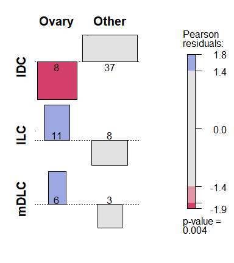<!-- -->

# …………………………………………………………………………….

# A. RNAseq

## Sup Figure 5 - RNAseq QC and exploratory analysis

### Sup Fig 5A - QC

``` r
# LOAD QORTS DATA.FRAME
load("../input/Qorts_QC_summary_df.Rdata")


# INSERT SIZE
supFig5a_1 = ggplot(summary_qc_df, aes(x = InsertSize_Mean))+
  geom_density(fill="cyan",alpha = 0.5, color="white")+myTheme+xlab("Mean Insert Size")+
  geom_vline(xintercept = median(summary_qc_df$InsertSize_Mean), color="red",linetype="dashed")+ylab("density")+
  annotate("text", label="Median\n325.2", x = 390, y = 0.0075, size = 4, fontface="bold")+theme(axis.text.y = element_blank())


# GC CONTENT
supFig5a_2 = ggplot(summary_qc_df, aes(x = GC_byRead_Mean))+
  geom_density(fill="cyan",alpha = 0.5, color="white")+myTheme+xlab("Read Mean GC %")+
  geom_vline(xintercept = median(summary_qc_df$GC_byRead_Mean), color="red",linetype="dashed")+ ylab("density")+
  annotate("text", label="Median\n37.43", x = 38.2, y = 0.4, size = 4, fontface="bold")+theme(axis.text.y = element_blank())


# MAPPED READS
summary_qc_df$`Mapped Reads (Million)`=summary_qc_df$ReadPairs_UniqueGene/1e6
summary_qc_df[summary_qc_df$`Mapped Reads (Million)` >= 10,"Map QC"]="Pass"
summary_qc_df[summary_qc_df$`Mapped Reads (Million)` <= 10,"Map QC"]="Fail"

supFig5a_3 = ggplot(summary_qc_df, aes(y=`Mapped Reads (Million)`, x = reorder(ID,`Mapped Reads (Million)`),
                           label = ID, color = factor(`Map QC`)))+
  geom_point(size = 2) + myTheme + theme(axis.text.x = element_blank()) + xlab("Rank")+
  geom_hline(yintercept = 10, color="red", linetype="dashed")+
  ggrepel::geom_label_repel(data = subset(summary_qc_df, `Map QC` == "Fail"), show.legend = F) + scale_color_manual("Read QC", values = c("red","blue")) + theme(legend.position = c(0.37, 0.79))


supFig5a_left = ggarrange(plotlist = list(supFig5a_1, supFig5a_2), ncol = 1, nrow = 2)
supFig5a = ggarrange(plotlist = list(supFig5a_left, supFig5a_3), ncol = 2, nrow = 1)
supFig5a
```

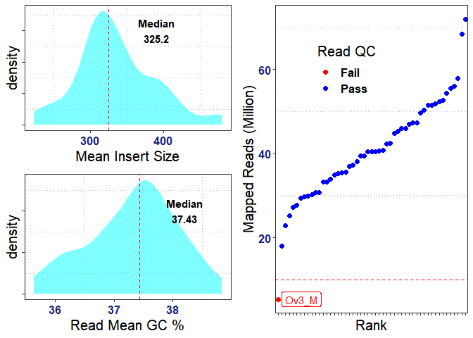<!-- -->

``` r
# supFig5a_left_plotly = plotly::subplot(supFig5a_1, supFig5a_2, nrows = 2)
# supFig5a_plotly = plotly::subplot(supFig5a_left_plotly, supFig5a_3)
```

``` r
#### OUTLIER SAMPLE
excluded_samples = c("0006-56M") # failed mapping rate
```

### Sup Fig 5B - Tumor Match

``` r
load("../input/RNAseq_TumorMatch.Rdata")

library(ComplexHeatmap)

cols = c('green','white','red')
clinData_select = subset(clinData, Subtype %in% c("IDC","ILC","mDLC") & 
                           TissueType %notin% "Normal" & Study_Code %in% "Ovary" & 
                           SampleID %notin% excluded_samples)

clinData_select = subset(clinData_select, SampleID %in% rownames(tumorMatch.scores.df) & 
                           Patient_ID %in% names(which(table(clinData_select$Patient_ID) > 1)))

length(unique(clinData_select$Patient_ID))
```

    ## [1] 12

``` r
cols_ = c(RColorBrewer::brewer.pal(n = 9, name="Set1"),RColorBrewer::brewer.pal(n = 3, name="Set2"))
names(cols_) = unique(clinData_select$Patient_ID)

simMat = as.matrix(tumorMatch.scores.df[clinData_select$SampleID, clinData_select$SampleID])
colnames(simMat) = clinData_select[colnames(simMat), "SimpleID"]
colnames(simMat) = gsub(x = colnames(simMat), pattern = "M_",replacement = "M-")
colnames(simMat) = gsub(x = colnames(simMat), pattern = "_",replacement = " ")#," - ",
rownames(simMat) = colnames(simMat)
set.seed(123); tumorMatch_HT = Heatmap(simMat, col = viridis::magma((100)), name = "TumorMatch",
        bottom_annotation = HeatmapAnnotation(show_annotation_name = F,Patient_ID = clinData_select[, "Patient_ID"],col = list(Patient_ID = cols_)),
        right_annotation = HeatmapAnnotation(show_annotation_name = F,which = "row", Patient_ID = clinData_select[, "Patient_ID"], 
                                             col = list(Patient_ID = cols_)))
```

``` r
draw(tumorMatch_HT, merge = T)
```

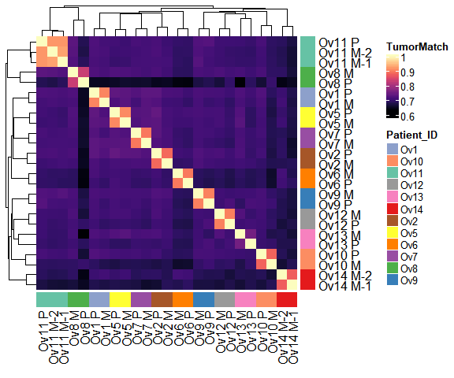<!-- -->

``` r
##### PREPARE INPUTS FOR EXPLORATORY ANALYSIS

# Clinical Data
clinData_select = subset(clinData, Subtype %in% c("IDC","ILC","mDLC") & 
                           TissueType %notin% "Normal" & Study_Code %in% "Ovary" & 
                           SampleID %notin% excluded_samples)
dim(clinData_select)
```

    ## [1] 38 14

``` r
#length(sort(clinData_select$Patient_ID))
#clinData_select[order(clinData_select$SimpleID), c("Patient_ID", "SampleID")]

## VST normalization
library(DESeq2)

mode(cts_genes)="integer"
dim(cts_genes)
```

    ## [1] 19100   143

``` r
dds <- DESeqDataSetFromMatrix(countData = cts_genes[, clinData_select$SampleID], 
                              colData = clinData_select, design = ~TissueType)
dds <- estimateSizeFactors(dds)
vstDF <- vst(dds, blind = TRUE) # TRANSFORMATION IS NOT EFFECTED BY EXPERIMENTAL DESIGN -> BLINE => TRUE
```

``` r
###### Top variable features
selected_vstDF = vstDF
selected_clinData = clinData_select


## Variable Features
feature.vars = apply(assay(selected_vstDF)[, selected_clinData$SampleID], MARGIN = 1, var)
feature.vars = sort(feature.vars, decreasing = T)
length(feature.vars)
```

    ## [1] 19100

``` r
# top var gene PCA
select_features = names(selected_vstDF)[1:(length(names(feature.vars))*10/100)] # top 10% variable genes
```

### Sup Fig 5C - Clustering Heatmap

``` r
sampleDists <- as.matrix(dist(t(assay(vstDF[select_features, selected_clinData$SampleID]))))


library(ComplexHeatmap)

sampleDists = sampleDists[selected_clinData$SampleID, selected_clinData$SampleID]
rownames(sampleDists)=clinData[rownames(sampleDists), "SimpleID"]

colnames(sampleDists) = gsub(x = colnames(sampleDists), pattern = "M_",replacement = "M-")
colnames(sampleDists) = gsub(x = colnames(sampleDists), pattern = "_",replacement = " ")
rownames(sampleDists) = colnames(sampleDists)

htAnnot = HeatmapAnnotation(show_legend = T, 
                            Subtype = selected_clinData$Subtype, ER = selected_clinData$ER_infered, 
                            `Tissue Type` = selected_clinData$TissueType, PAM50 = selected_clinData$PAM50,
                            `Metastasis Type` = selected_clinData$Paired, Purity = selected_clinData$Estimate_Purity, 
                            Immune = selected_clinData$Immune_Scores, col = annot_col,
                            annotation_name_gp = gpar(fontsize = 12, fontface="bold", col="#616161"), 
                            annotation_name_side = "left", simple_anno_size = unit(5,"mm"))

set.seed(123); dist_ht = Heatmap(sampleDists, show_column_names = F, 
                       show_row_names = T, name = "Euclidean\nDistance",show_heatmap_legend = T,
                       row_names_side = "left", row_names_gp = gpar(fontsize = 10, fontface="bold"),
                       row_dend_side = "right",column_dend_side = "bottom", 
                       top_annotation =  htAnnot)
draw(dist_ht, merge = T,  heatmap_legend_side = "bottom")
```

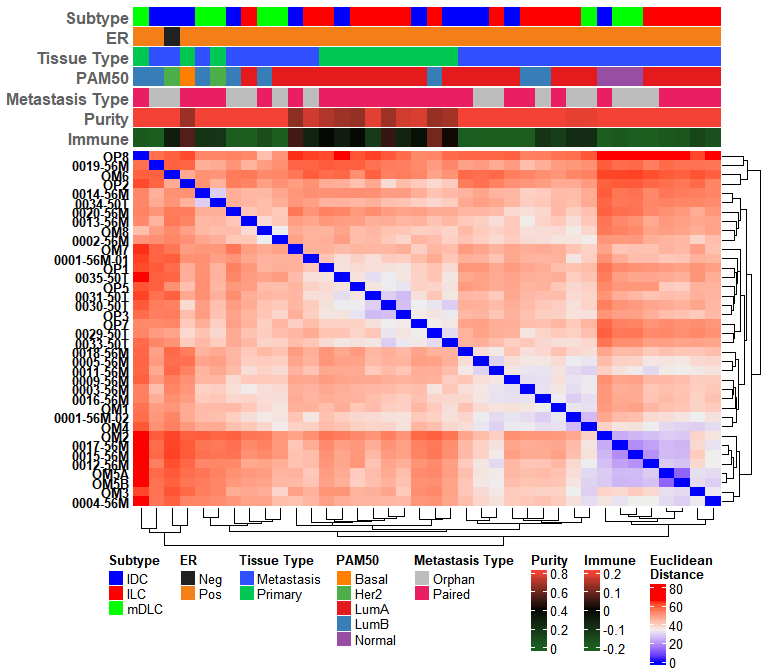<!-- -->

### Sup Fig 5D - PCA Analysis

``` r
################################### Sup Fig 5D - PCA Analysis
## Select Cohort and Clinical data
# PCA
set.seed(123); pca_res_ova_cohort <- prcomp(t(assay(selected_vstDF)[select_features, selected_clinData$SampleID]))

PC_1 = 1
PC_2 = 2

plt_df = data.frame(PC1 = -pca_res_ova_cohort$x[, PC_1], PC2 = -pca_res_ova_cohort$x[, PC_2], 
                  labels = selected_clinData$SampleID, 
                  groups = selected_clinData$Study_Code,
                  Subtype = selected_clinData$Subtype,
                  TissueType = selected_clinData$TissueType,
                  Site = selected_clinData$TissueSite,
                  PAM50 = selected_clinData$PAM50,
                  CDH1 = as.numeric(log2_tpm_genes["CDH1",selected_clinData$SampleID]),
                  purity = selected_clinData$Estimate_Purity,
                  ER = selected_clinData$ER,
                  ER_infered = selected_clinData$ER_infered)

summary(pca_res_ova_cohort)$importance
```

    ##                           PC1     PC2     PC3     PC4     PC5     PC6     PC7
    ## Standard deviation     15.301 11.8894 8.46665 7.70771 7.41189 6.08701 5.89672
    ## Proportion of Variance  0.232  0.1401 0.07105 0.05888 0.05445 0.03672 0.03446
    ## Cumulative Proportion   0.232  0.3721 0.44317 0.50205 0.55650 0.59322 0.62768
    ##                            PC8     PC9    PC10    PC11    PC12    PC13    PC14
    ## Standard deviation     5.53552 5.21621 5.04528 4.67131 4.56343 4.51915 4.42659
    ## Proportion of Variance 0.03037 0.02697 0.02523 0.02163 0.02064 0.02024 0.01942
    ## Cumulative Proportion  0.65805 0.68502 0.71024 0.73187 0.75251 0.77275 0.79217
    ##                           PC15    PC16    PC17    PC18    PC19    PC20    PC21
    ## Standard deviation     4.30703 4.25712 4.02754 3.79163 3.71097 3.66582 3.48492
    ## Proportion of Variance 0.01839 0.01796 0.01608 0.01425 0.01365 0.01332 0.01204
    ## Cumulative Proportion  0.81056 0.82852 0.84460 0.85884 0.87249 0.88581 0.89785
    ##                          PC22    PC23    PC24    PC25    PC26    PC27    PC28
    ## Standard deviation     3.3315 3.24195 3.21770 3.10002 2.89300 2.71590 2.61721
    ## Proportion of Variance 0.0110 0.01042 0.01026 0.00952 0.00829 0.00731 0.00679
    ## Cumulative Proportion  0.9089 0.91926 0.92953 0.93905 0.94735 0.95466 0.96144
    ##                           PC29   PC30    PC31    PC32    PC33    PC34    PC35
    ## Standard deviation     2.51545 2.4184 2.37305 2.21012 2.08859 1.96678 1.84494
    ## Proportion of Variance 0.00627 0.0058 0.00558 0.00484 0.00432 0.00383 0.00337
    ## Cumulative Proportion  0.96772 0.9735 0.97909 0.98394 0.98826 0.99209 0.99547
    ##                           PC36    PC37                PC38
    ## Standard deviation     1.75734 1.21927 0.00000000000002218
    ## Proportion of Variance 0.00306 0.00147 0.00000000000000000
    ## Cumulative Proportion  0.99853 1.00000 1.00000000000000000

``` r
prop <- as.data.frame(summary(pca_res_ova_cohort)[[6]])
Propf <- round(prop[2,],3)*100

dim(plt_df)
```

    ## [1] 38 12

``` r
# Plot discrete variables
supFig5d_1 = ggplot(plt_df,  aes(x = PC1, y = PC2, color=(PAM50), label = labels))+myTheme+
  geom_point(size = 4) + 
  xlab(paste0("PC",PC_1," (",Propf[PC_1],"%)")) + ylab(paste0("PC",PC_2," (",Propf[PC_2],"%)")) + 
  scale_color_manual("PAM50", values = annot_col$PAM50)+
  theme(axis.text = element_blank())+ theme(legend.position = "right", legend.direction = "vertical")

supFig5d_2 = ggplot(plt_df,  aes(x = PC1, y = PC2, color=(TissueType), label = labels))+myTheme+
  geom_point(size = 4) + 
  xlab(paste0("PC",PC_1," (",Propf[PC_1],"%)")) + ylab(paste0("PC",PC_2," (",Propf[PC_2],"%)")) + 
  scale_color_manual("Tissue Type", values = annot_col$`Tissue Type`[c(1:2)])+
  theme(axis.text = element_blank())+ theme(legend.position = "right", legend.direction = "vertical")#+

supFig5d_3 = ggplot(plt_df,  aes(x = PC1, y = PC2, color=(Subtype), label = labels))+myTheme+
  geom_point(size = 4) + 
  xlab(paste0("PC",PC_1," (",Propf[PC_1],"%)")) + ylab(paste0("PC",PC_2," (",Propf[PC_2],"%)")) + 
  scale_color_manual("Subtype", values = annot_col$Subtype[c(1:3)])+
  theme(axis.text = element_blank())+ theme(legend.position = "right", legend.direction = "vertical")#+

# plot continous variable
supFig5d_4 = ggplot(plt_df,  aes(x = PC1, y = PC2, color=(purity), label = labels))+myTheme+
  geom_point(size = 4) + scale_color_continuous("Purity", type = "viridis")+
  xlab(paste0("PC",PC_1," (",Propf[PC_1],"%)")) + ylab(paste0("PC",PC_2," (",Propf[PC_2],"%)")) + 
  theme(axis.text = element_blank())+ theme(legend.position = "right")

###################################


supFig5d = ggarrange(plotlist = list(supFig5d_2, supFig5d_4, supFig5d_3, supFig5d_1), ncol = 2, nrow = 2, 
          widths = c(1.2, 1.2, 1, 1))
supFig5d
```

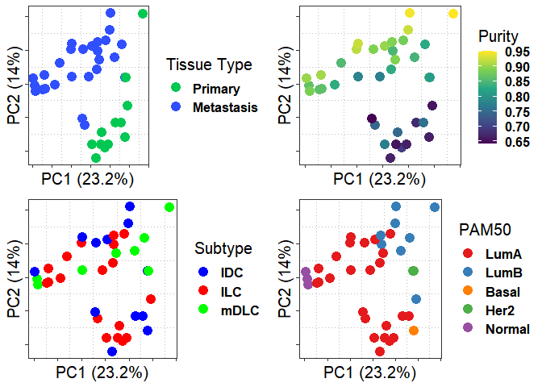<!-- -->

## Figure 3 - PAM50 subtyping and molecular landscape of ovary metastasis

``` r
## LOAD PAM50 DATA
pam50.output.df = read.delim("../output/annotations/PAM50/pam50_calls.txt")
rownames(pam50.output.df)=pam50.output.df$X

pam50.prob.df = read.delim("../output/annotations/PAM50/pam50_probs.txt")
rownames(pam50.prob.df)=pam50.prob.df$X
pam50.prob.df = pam50.prob.df[,-1]


########################################### Figure 3A PAM50 score plot -------------------------------------------------

# clinical data on ovary metastasis cohort exlcuding normal samples
clinData_OvaryMetCohort_no_normal = subset(clinData, Subtype %in% c("IDC","ILC","mDLC") & 
                                    TissueType %notin% "Normal" & SampleID %notin% excluded_samples &
                                    Study_Code %in% "Ovary")

# make pam50 score data frame
df_PAM50_genefu_score = pam50.prob.df[clinData_OvaryMetCohort_no_normal$SampleID,]
df_PAM50_genefu_score = as.data.frame(df_PAM50_genefu_score)
df_PAM50_genefu_score$`PAM50 Final`=factor(pam50.output.df[rownames(df_PAM50_genefu_score),"PAM50.subtype"], levels = c("LumA", "LumB", "Basal", "Her2", "Normal"))
df_PAM50_genefu_score$SampleID = rownames(df_PAM50_genefu_score)
df_PAM50_genefu_melt = melt(df_PAM50_genefu_score)
names(df_PAM50_genefu_melt)=c("PAM50 Final","SampleID","PAM50","Score")

df_PAM50_genefu_melt$PAM50 <- factor(df_PAM50_genefu_melt$PAM50, levels = c( "Basal", "Her2","LumA", "LumB", "Normal"))
df_PAM50_genefu_melt$Subtype = clinData_OvaryMetCohort_no_normal[df_PAM50_genefu_melt$SampleID,"Subtype"]
df_PAM50_genefu_melt$Study_Code = clinData_OvaryMetCohort_no_normal[df_PAM50_genefu_melt$SampleID,"Study_Code"]
df_PAM50_genefu_melt$TissueType = clinData_OvaryMetCohort_no_normal[df_PAM50_genefu_melt$SampleID,"TissueType"]
df_PAM50_genefu_melt$ER = clinData_OvaryMetCohort_no_normal[df_PAM50_genefu_melt$SampleID, "ER"]
df_PAM50_genefu_melt$HER2 = clinData_OvaryMetCohort_no_normal[df_PAM50_genefu_melt$SampleID, "HER2"]
df_PAM50_genefu_melt$Patient_ID = clinData_OvaryMetCohort_no_normal[df_PAM50_genefu_melt$SampleID, "Patient_ID"]
df_PAM50_genefu_melt$Patient_ID_2 = clinData_OvaryMetCohort_no_normal[df_PAM50_genefu_melt$SampleID, "SimpleID"]
df_PAM50_genefu_melt$Paired = clinData_OvaryMetCohort_no_normal[df_PAM50_genefu_melt$SampleID, "Paired"]

# order the samples for plot
df_PAM50_genefu_melt$SampleID = factor(df_PAM50_genefu_melt$SampleID, 
                                       levels = clinData_OvaryMetCohort_no_normal$SampleID[order(clinData_OvaryMetCohort_no_normal$Patient_ID,clinData_OvaryMetCohort_no_normal$TissueType, decreasing = T)])

# fix names and order IDs
df_PAM50_genefu_melt$ID = gsub(x = df_PAM50_genefu_melt$Patient_ID_2, pattern = "M_",replacement = "M-")
df_PAM50_genefu_melt$ID = gsub(x = df_PAM50_genefu_melt$ID, pattern = "_",replacement = " ")
df_PAM50_genefu_melt$ID = factor(df_PAM50_genefu_melt$ID, 
                                      levels = rev(unique(df_PAM50_genefu_melt$ID[
                                        order(paste0(df_PAM50_genefu_melt$Paired, 
                                                     df_PAM50_genefu_melt$ID), decreasing = T)])))


### Define PAM50 switching (if at least 1 pam50 subtype probs change by 0.25) ------
sampleID_name_map = df_PAM50_genefu_melt[, c("SampleID", "ID")]
sampleID_name_map = sampleID_name_map[!duplicated(sampleID_name_map$SampleID), ]
rownames(sampleID_name_map) = as.character(sampleID_name_map$SampleID)
sampleID_name_map$ID = as.character(sampleID_name_map$ID)

matrix_name = levels(df_PAM50_genefu_melt$SampleID)
PAM50_switch_mat = matrix("No", nrow = length(matrix_name), ncol = 1)
rownames(PAM50_switch_mat) = levels(df_PAM50_genefu_melt$SampleID)

for (met_ID in subset(clinData_OvaryMetCohort_no_normal, TissueType %in% "Metastasis")$SampleID) {
  PatientID = clinData_OvaryMetCohort_no_normal[met_ID, "Patient_ID"]
  pri_ID = subset(clinData_OvaryMetCohort_no_normal, TissueType %in% "Primary" & Patient_ID %in% PatientID)$SampleID
  
  if (length(pri_ID) > 0){
    met_PAM50_scores = df_PAM50_genefu_score[met_ID, c("Basal", "Her2", "LumA", "LumB", "Normal")]
    pri_PAM50_scores = df_PAM50_genefu_score[pri_ID, c("Basal", "Her2", "LumA", "LumB", "Normal")]
    if (sum(abs(met_PAM50_scores - pri_PAM50_scores) > 0.25) > 0){
      PAM50_switch_mat[met_ID,] = "Yes"
    }
  }
}

rownames(PAM50_switch_mat) = sampleID_name_map[rownames(PAM50_switch_mat), "ID"]
PAM50_switch_mat = PAM50_switch_mat[,1]

df_PAM50_genefu_melt$switch = PAM50_switch_mat[as.character(df_PAM50_genefu_melt$ID)]
###-----
```

### Fig 3A - PAM50 scores

``` r
## Prepare visualizations

# panel A
PAM50 = ggplot(df_PAM50_genefu_melt, aes(x = ID, y = factor(PAM50), fill = Score))+
  geom_tile(alpha = 0.5, show.legend = T, color="black") + scale_fill_gradient("Score", low = "#FAFAFA", high = "#b71c1c") + 
  myTheme+xlab("")+ylab("")+geom_text(show.legend = F, aes(label = round(Score,2), size = Score)) + 
  theme(axis.text.x = element_text(angle = 45, vjust = 1, hjust = 1))+
  coord_flip()+blankTheme + theme(plot.margin = unit(c(0,2,1.4,-1.8), "lines"), 
                                  axis.text.y = element_blank(),
                                  axis.ticks.y = element_blank(),
                                  legend.position = "left") +
  guides(color = FALSE, size = FALSE)


# panel B
tissue_type_col = ifelse(grepl(x=(levels(df_PAM50_genefu_melt$ID)),pattern = "M"), "#d32f2f","#388E3C")
tissue_type_Face = ifelse(PAM50_switch_mat[levels(df_PAM50_genefu_melt$ID)] == "Yes", "bold", "plain")

PAM50final = ggplot(df_PAM50_genefu_melt, aes(x = ID, y="Assignment", fill=`PAM50 Final`))+
  geom_tile(show.legend = T,color="black")+xlab("")+ylab("")+scale_fill_manual("Assignment", values = pam50_cols)+
  coord_flip() + myTheme + blankTheme + 
  theme(axis.text.y = element_text(color = tissue_type_col, face = tissue_type_Face), 
        axis.ticks.y = element_blank(),
        axis.text.x = element_text(angle = 45, vjust = 1, hjust = 1), legend.position = "left")# + 


# legends
legends = ggarrange(plotlist = list(get_legend(PAM50final),get_legend(PAM50)), 
                    nrow = 2, widths = c(0.5,0.5), heights = c(1,1.5), align = 'v')


# merge panels + legends
fig3a = ggarrange(plotlist = list(PAM50final + theme(legend.position = 'none'), 
                          PAM50 + theme(legend.position = 'none'), 
                          legends),  ncol = 3, widths = c(0.5,0.9,0.4),  heights = c(4,4,2))


###########################################


fig3a
```

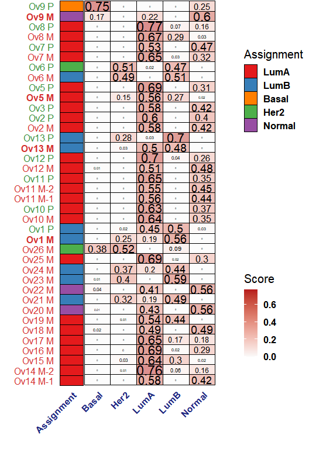<!-- -->

``` r
########################################### Figure 3B PAM50 assignment barplots -------------------------------------------------
df_PAM50_genefu = data.frame(SampleID = clinData_OvaryMetCohort_no_normal$SampleID)
rownames(df_PAM50_genefu) = df_PAM50_genefu$SampleID
df_PAM50_genefu$PAM50 = factor(pam50.output.df[rownames(df_PAM50_genefu),"PAM50.subtype"], levels = c("LumA", "LumB", "Basal", "Her2", "Normal"))

df_PAM50_genefu$Subtype = clinData_OvaryMetCohort_no_normal[df_PAM50_genefu$SampleID,"Subtype"]
df_PAM50_genefu$Study_Code = clinData_OvaryMetCohort_no_normal[df_PAM50_genefu$SampleID,"Study_Code"]
df_PAM50_genefu$TissueType = factor(x = clinData_OvaryMetCohort_no_normal[df_PAM50_genefu$SampleID,"TissueType"], levels = c("Primary","Metastasis"))
df_PAM50_genefu$ER = clinData_OvaryMetCohort_no_normal[df_PAM50_genefu$SampleID, "ER"]
df_PAM50_genefu$HER2 = clinData_OvaryMetCohort_no_normal[df_PAM50_genefu$SampleID, "HER2"]
df_PAM50_genefu$Patient_ID = clinData_OvaryMetCohort_no_normal[df_PAM50_genefu$SampleID, "Patient_ID"]
df_PAM50_genefu$Paired = clinData_OvaryMetCohort_no_normal[df_PAM50_genefu$SampleID, "Paired"]
df_PAM50_genefu$Site = clinData_OvaryMetCohort_no_normal[df_PAM50_genefu$SampleID, "TissueSite"]

df_PAM50_genefu$SampleID = factor(df_PAM50_genefu$SampleID, 
                                  levels = clinData_OvaryMetCohort_no_normal$SampleID[order(clinData_OvaryMetCohort_no_normal$Patient_ID, 
                                                                                   clinData_OvaryMetCohort_no_normal$TissueType, decreasing = T)])
```

### Fig 3B - PAM50 assignment across Subtypes

``` r
make_pam50_barplot = function(df_PAM50_genefu, showlegend = F){
  table(clinData_OvaryMetCohort_no_normal$TissueType)
  pri_met_pam50_freq = df_PAM50_genefu %>% group_by(TissueType, `PAM50`) %>% summarise(n = n()) %>% group_by(TissueType) %>% 
    mutate(Percentage = 100*n/sum(n)) %>% as.data.frame()
  pri_met_pam50_freq[pri_met_pam50_freq$TissueType %in% "Primary","order"] = order(pri_met_pam50_freq[pri_met_pam50_freq$TissueType %in% "Primary",
                                                                                                      "Percentage"], decreasing = T)
  pri_met_pam50_freq[pri_met_pam50_freq$TissueType %in% "Metastasis","order"]=order(pri_met_pam50_freq[pri_met_pam50_freq$TissueType %in% "Metastasis",
                                                                                                       "Percentage"], decreasing = T)
  pri_met_pam50_freq = pri_met_pam50_freq[order(pri_met_pam50_freq$Percentage),]
  
  ## ALL PRI AND MET
  pri_n = sum(subset(pri_met_pam50_freq, TissueType %in% "Primary")$n)
  met_n = sum(subset(pri_met_pam50_freq, TissueType %in% "Metastasis")$n)
  
  set.seed(1432); fig = ggplot(pri_met_pam50_freq, aes(TissueType, Percentage, fill = reorder(`PAM50`,X = order)))+
  geom_bar(stat = "identity", color="black", show.legend = showlegend)+
  scale_fill_manual("PAM50",values = pam50_cols)+myTheme+xlab("") + 
  annotate("text", label = paste("N =",pri_n), fontface="bold", size = 4.5, color="darkgray", x = 1, y = -4) + 
  annotate("text", fontface="bold", size = 4.5, color="darkgray", label = paste("N =",met_n), x = 2, y = -4) + 
  geom_label(aes(label = n), hjust = 0.5, vjust = 0.6, fill="white", fontface ="bold", size = 4, show.legend = showlegend, position = "stack")
  
  return(fig)
}

fig3b_1 = make_pam50_barplot(df_PAM50_genefu, showlegend = F)
fig3b_2 = make_pam50_barplot(subset(df_PAM50_genefu, Subtype %in% "ILC"), showlegend = F)
fig3b_3 = make_pam50_barplot(subset(df_PAM50_genefu, Subtype %in% "mDLC"), showlegend = F)
fig3b_4 = make_pam50_barplot(subset(df_PAM50_genefu, Subtype %in% "IDC"), showlegend = F)

fig3b = ggarrange(plotlist = list(fig3b_1, fig3b_2, fig3b_3, fig3b_4), ncol = 4)
```

``` r
fig3b
```

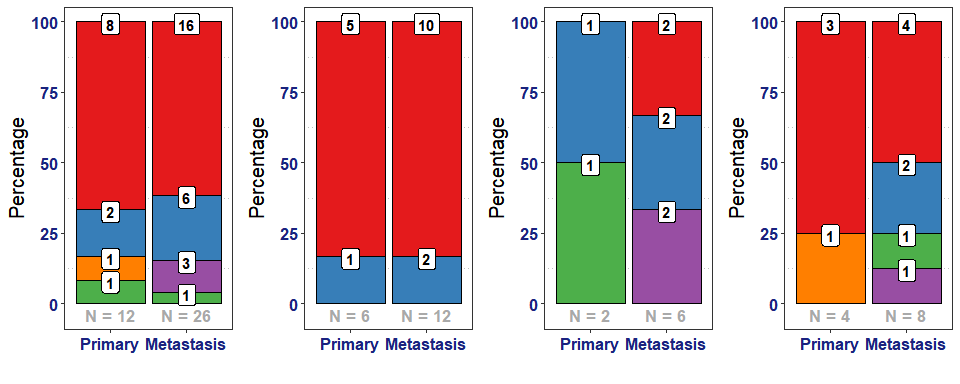<!-- -->

### Fig 3C - Ovary Metastasis Subtype Exploratory Analysis

``` r
# Clinical Data for Metastasis
clinData_Ova_Mets = subset(clinData, TissueType %in% "Metastasis" & Study_Code %in% "Ovary" & 
                           SampleID %notin% excluded_samples)
clinData_Ova_Mets[order(clinData_Ova_Mets$SimpleID), c("Patient_ID", "SampleID")]
```

    ##             Patient_ID    SampleID
    ## 0003-56M           Ov1    0003-56M
    ## OM3               Ov10         OM3
    ## OM5A              Ov11        OM5A
    ## OM5B              Ov11        OM5B
    ## OM7               Ov12         OM7
    ## OM8               Ov13         OM8
    ## 0001-56M-01       Ov14 0001-56M-01
    ## 0001-56M-02       Ov14 0001-56M-02
    ## 0002-56M          Ov15    0002-56M
    ## 0005-56M          Ov16    0005-56M
    ## 0011-56M          Ov17    0011-56M
    ## 0012-56M          Ov18    0012-56M
    ## 0013-56M          Ov19    0013-56M
    ## 0004-56M           Ov2    0004-56M
    ## 0015-56M          Ov20    0015-56M
    ## 0016-56M          Ov21    0016-56M
    ## 0017-56M          Ov22    0017-56M
    ## 0019-56M          Ov23    0019-56M
    ## 0020-56M          Ov24    0020-56M
    ## OM4               Ov25         OM4
    ## OM6               Ov26         OM6
    ## 0009-56M           Ov5    0009-56M
    ## 0014-56M           Ov6    0014-56M
    ## 0018-56M           Ov7    0018-56M
    ## OM1                Ov8         OM1
    ## OM2                Ov9         OM2

``` r
## VST normalization
library(DESeq2)

mode(cts_genes)="integer"
dds <- DESeqDataSetFromMatrix(countData = cts_genes[,clinData_Ova_Mets$SampleID], 
                              colData = clinData_Ova_Mets, design = ~Subtype)
dds <- estimateSizeFactors(dds)
vstDF <- vst(dds, blind = TRUE)

## Select Cohort and Clinical data
selected_vstDF = vstDF
selected_clinData = clinData_Ova_Mets

## Variable Features
feature.vars = apply(assay(selected_vstDF)[, selected_clinData$SampleID], MARGIN = 1, var) #[,clinData_Ovary$SampleID]
feature.vars = sort(feature.vars,decreasing = T)


# top var gene PCA
select_features = names(selected_vstDF)[1:(length(names(feature.vars))*10/100)] # top 10% variable genes
```

``` r
set.seed(123); pca_res_ova_cohort <- prcomp(t(assay(selected_vstDF)[select_features, selected_clinData$SampleID]))

PC_1 = 1
PC_2 = 2

plt_df = data.frame(PC1 = pca_res_ova_cohort$x[, PC_1], PC2 = -pca_res_ova_cohort$x[, PC_2], 
                  labels = selected_clinData$SampleID, 
                  groups = selected_clinData$Study_Code,
                  Subtype = selected_clinData$Subtype,
                  TissueType = selected_clinData$TissueType,
                  Site = selected_clinData$TissueSite,
                  PAM50 = selected_clinData$PAM50,
                  CDH1 = as.numeric(log2_tpm_genes["CDH1",selected_clinData$SampleID]),
                  purity = selected_clinData$Estimate_Purity,
                  ER = selected_clinData$ER,
                  ER_infered = selected_clinData$ER_infered)

summary(pca_res_ova_cohort)$importance
```

    ##                            PC1    PC2     PC3     PC4     PC5     PC6    PC7
    ## Standard deviation     15.9075 9.7041 9.09528 7.94368 6.70425 6.68581 6.0589
    ## Proportion of Variance  0.2737 0.1018 0.08946 0.06824 0.04861 0.04834 0.0397
    ## Cumulative Proportion   0.2737 0.3755 0.46495 0.53319 0.58180 0.63014 0.6698
    ##                            PC8     PC9    PC10    PC11    PC12   PC13    PC14
    ## Standard deviation     6.00161 5.78032 5.41729 5.05090 4.67319 4.5307 4.51751
    ## Proportion of Variance 0.03895 0.03613 0.03174 0.02759 0.02362 0.0222 0.02207
    ## Cumulative Proportion  0.70879 0.74492 0.77666 0.80425 0.82786 0.8501 0.87213
    ##                          PC15    PC16    PC17    PC18    PC19    PC20    PC21
    ## Standard deviation     4.2897 4.11699 3.88992 3.71529 3.46795 3.36746 3.02488
    ## Proportion of Variance 0.0199 0.01833 0.01636 0.01493 0.01301 0.01226 0.00989
    ## Cumulative Proportion  0.8920 0.91036 0.92673 0.94165 0.95466 0.96692 0.97682
    ##                           PC22    PC23    PC24    PC25                PC26
    ## Standard deviation     2.96036 2.34894 2.20766 1.51077 0.00000000000002195
    ## Proportion of Variance 0.00948 0.00597 0.00527 0.00247 0.00000000000000000
    ## Cumulative Proportion  0.98629 0.99226 0.99753 1.00000 1.00000000000000000

``` r
prop <- as.data.frame(summary(pca_res_ova_cohort)[[6]])
Propf <- round(prop[2,],3)*100

dim(plt_df)
```

    ## [1] 26 12

``` r
# Plot discrete variables
fig3c_1 = ggplot(plt_df,  aes(x = PC1, y = PC2, color=(Subtype), label = labels))+myTheme+
  geom_point(size = 4) + 
  xlab(paste0("PC",PC_1," (",Propf[PC_1],"%)")) + ylab(paste0("PC",PC_2," (",Propf[PC_2],"%)")) + 
  scale_color_manual("Subtype", values = annot_col$Subtype[c(1:3)])+
  theme(axis.text = element_blank())+ theme(legend.position = "right", legend.direction = "vertical")#+

fig3c_2 = ggplot(plt_df,  aes(x = PC1, y = PC2, color=(PAM50), label = labels))+myTheme+
  geom_point(size = 4) + 
  xlab(paste0("PC",PC_1," (",Propf[PC_1],"%)")) + ylab(paste0("PC",PC_2," (",Propf[PC_2],"%)")) + 
  scale_color_manual("PAM50", values = annot_col$PAM50)+
  theme(axis.text = element_blank())+ theme(legend.position = "right", legend.direction = "vertical")

# plot continous variable
fig3c_3 = ggplot(plt_df,  aes(x = PC1, y = PC2, color=(CDH1), label = labels))+myTheme+
  geom_point(size = 4) + scale_color_continuous("CDH1", type = "viridis")+
  xlab(paste0("PC",PC_1," (",Propf[PC_1],"%)")) + ylab(paste0("PC",PC_2," (",Propf[PC_2],"%)")) + 
  theme(axis.text = element_blank())+ theme(legend.position = "right")

fig3c_4 = ggplot(plt_df,  aes(x = PC1, y = PC2, color=(purity), label = labels))+myTheme+
  geom_point(size = 4) + scale_color_continuous("Purity", type = "viridis")+
  xlab(paste0("PC",PC_1," (",Propf[PC_1],"%)")) + ylab(paste0("PC",PC_2," (",Propf[PC_2],"%)")) + 
  theme(axis.text = element_blank())+ theme(legend.position = "right")

###################################


fig3c = ggarrange(plotlist = list(fig3c_1, fig3c_2, fig3c_3, fig3c_4), ncol = 2, nrow = 2, 
          widths = c(1.2, 1.2, 1, 1))
fig3c
```

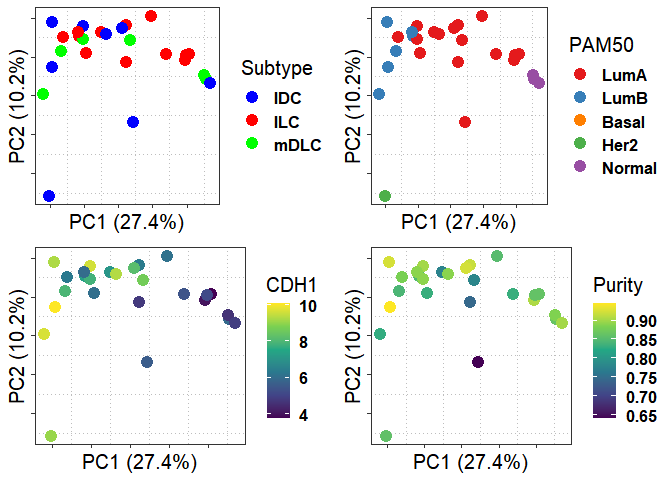<!-- -->

### Fig 3D - CDH1 Expression

``` r
mkDF = function(gene, clinData){
  data.frame(
             geneLog2TPM = as.numeric(log2_tpm_genes[gene, clinData$SampleID]), 
             SampleIDs= clinData$SampleID, 
             Subtype = clinData$Subtype, 
             Group = clinData$Patient_ID,
             TissueType = clinData$TissueType,
             Site = clinData$TissueSite, 
             ER_infered = clinData$ER_infered, 
             ER = clinData$ER, 
             Study = clinData$Study_Code,
             PAM50 = clinData$PAM50,
             Paired = clinData$Paired,
             Purity = clinData$Estimate_Purity,
             stringsAsFactors = F
             )
  }
```

``` r
### MET SUBTYPE COMPARISON
gene = "CDH1"
met_cdh1_df = mkDF(gene, clinData_Ova_Mets)

fig3D = ggplot(met_cdh1_df, aes(reorder(Subtype, geneLog2TPM), geneLog2TPM, label = SampleIDs)) + ## AES
  geom_boxplot(na.rm = T, outlier.colour = NA, color="gray", fill = "gray", alpha = 0.5) + 
  geom_jitter(aes(color = Subtype), size = 3, alpha = 0.8) + stat_n_text() + 
  ylab(paste0("Log2 ", gene," Expression")) + scale_y_continuous(labels = scales::number_format(accuracy = 1)) +  ## YLAB
  xlab("") +  stat_compare_means(comparisons = combn(unique(as.character(met_cdh1_df$Subtype)),m = 2, simplify = F),
                     label = "p.signif", size = 4, vjust = 1.2,
                     color="red", method = "wilcox.test", label.x.npc = 0.5) +  ## STATISTICS
  scale_color_manual("Histology",values = c("blue","red","green")) + 
  scale_fill_manual("Histology",values = c("blue","red","green")) + myTheme
```

``` r
fig3D
```

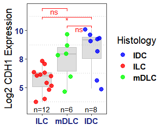<!-- -->

### Fig 3E - Ovary Metastasis ILC vs IDC DEA

``` r
# LOAD DEseq2 ANALYSIS
source("./Ovary_Met_ILCvsIDC_DEG_analysis.R")
OvILCvsIDC_met = run_DEseq2_Ovary_Met_ILCvIDC(cts = cts, clinData = clinData, excluded_samples)
```

    ## [1] "LOADING DESEQ2 results"
    ## [1] "ANNOTATING DESEQ2 results"

``` r
# SIGNIFICANT DEGS
OvILCvsIDC_met_sig = subset(OvILCvsIDC_met, padj < 0.05 & absLogFC >= 1.5)

# Supplementary data 3
OvILCvsIDC_met_sig$ensID = rownames(OvILCvsIDC_met_sig)
writexl::write_xlsx(OvILCvsIDC_met_sig, 
                    path = "../output/supplementary_data/Data 3 sheet 1 - Ovary Metastasis ILC vs IDC.xlsx")
```

``` r
# Select top 10 upregulated and downregulated DEGs
top10_ILCup = subset(OvILCvsIDC_met, log2FoldChange >= 1.5 & padj < 0.05)
top10_ILCup = top10_ILCup[order(top10_ILCup$absLogFC, top10_ILCup$log10Padj, decreasing = T),] %>% head(10)

top10_IDCup = subset(OvILCvsIDC_met, log2FoldChange <= -1.5 & padj < 0.05)
top10_IDCup = top10_IDCup[order(top10_IDCup$absLogFC, top10_IDCup$log10Padj, decreasing = T),] %>% head(10)
```

``` r
# make volcano plot
fig3E = ggplot(OvILCvsIDC_met, aes(x = log2FoldChange, y = -log10(padj), color = factor(log2FoldChange>0))) + myTheme + 
  geom_point(alpha = 0.8, aes(size = log10Padj)) + 
  scale_color_manual("Log2 FC",values = c("#1B5E20", "#f44336"), labels = c("Higher Exp\nin IDC", "Higher Exp\nin ILC")) + 
  guides(color = guide_legend(override.aes = list(size = 6)), size="none") + xlab("Log2 FC") + 
  geom_hline(yintercept = -log10(0.05), linetype="dashed") +
  geom_vline(xintercept = 1.5, linetype="dashed") + geom_vline(xintercept = -1.5, linetype="dashed") + 
  
  ggrepel::geom_label_repel(data = rbind(top10_ILCup, top10_IDCup), aes(label = Gene), max.overlaps = 100, 
                            show.legend = F) + 
  annotate(geom = "text", x = 5, y = -0.2, 
           label= paste0("Up (", as.numeric(table(OvILCvsIDC_met$log2FoldChange>0)[2]),")"), 
           size = 3.5, fontface="bold",color="darkgray") + 
  annotate(geom = "text", x = 5, y = -0.6, 
           label= paste0("Sig Up (",as.numeric(table(OvILCvsIDC_met_sig$log2FoldChange>0)[2]),")"), size = 3.5, 
           fontface="bold",color="darkgray") + 
  annotate(geom = "text", x = -5, y = -0.2, 
           label = paste0("Down (",as.numeric(table(OvILCvsIDC_met$log2FoldChange>0)[1]),")"), size = 3.5, 
           fontface = "bold",color="darkgray") + 
  annotate(geom = "text", x = -5, y = -0.6, 
           label= paste0("Sig Down (",as.numeric(table(OvILCvsIDC_met_sig$log2FoldChange>0)[1]),")"), 
           size = 3.5, fontface="bold",color="darkgray") + 
  ylim(c(-0.65, max(OvILCvsIDC_met$log10Padj))) + xlim(c(-8.5, 8.5))
```

``` r
fig3E
```

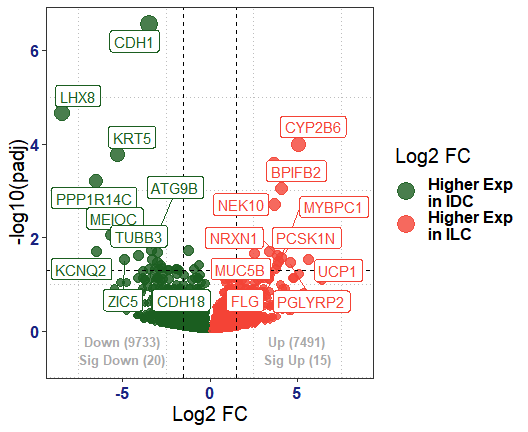<!-- -->

### Fig 3F - KEGG Pathway Analysis

``` r
ovMet_DEGs = list(`Up-regulated`= subset(OvILCvsIDC_met_sig, log2FoldChange >= 1.5)$Gene, 
                      `Down-regulated` = subset(OvILCvsIDC_met_sig, log2FoldChange <= -1.5)$Gene)

## hyper R
library(hypeR)
KEGG <- msigdb_gsets(species="Homo sapiens", category="C2", subcategory="CP:KEGG", clean = T)

ovMet_hyp_obj <- hypeR(ovMet_DEGs, KEGG, 
                 test="hypergeometric", pval = 0.05, plotting = F)
```

    ## Up-regulated
    ## Down-regulated

``` r
dn_reg_df = myEnrich_barplot(ovMet_hyp_obj$data$`Down-regulated`$data, plot_top_n = 10, abr = T, 
                          title = "Down-regulated - KEGG", bar_color = "#1B5E20",title_color = "#1B5E20", 
                          plot_fdr = F, add_cutoff = T)

up_reg_df = myEnrich_barplot(ovMet_hyp_obj$data$`Up-regulated`$data, plot_top_n = 10, abr = T, 
                          title = "Up-regulated - KEGG", bar_color = "#f44336",title_color = "#f44336", 
                        plot_fdr = F, add_cutoff = T)

icesTAF::mkdir("../output/pathway_analysis/hypeR/")
write.table(dn_reg_df$df, file = "../output/pathway_analysis/hypeR/OvaryMet_ILCvIDC_down_regulated - KEGG.tsv", 
            sep = "\t", row.names = F, quote = F)
write.table(up_reg_df$df, file = "../output/pathway_analysis/hypeR/OvaryMet_ILCvIDC_up_regulated - KEGG.tsv", 
            sep = "\t", row.names = F, quote = F)


# Supplementary data 4
writexl::write_xlsx(dn_reg_df$df,
                    path = "../output/supplementary_data/Data 4 sheet 1B - GSEA KEGG DEGS down-regulated in ILC metastasis.xlsx")

writexl::write_xlsx(up_reg_df$df,
                    path = "../output/supplementary_data/Data 4 sheet 1A - GSEA KEGG DEGS up-regulated in ILC metastasis.xlsx")
```

``` r
ggarrange(plotlist = list(dn_reg_df$plt + theme(axis.title.x = element_text(size = 15)) + xlab("-log10 Pvalue"),
                          up_reg_df$plt + theme(axis.title.x = element_text(size = 15)) + xlab("-log10 Pvalue")))
```

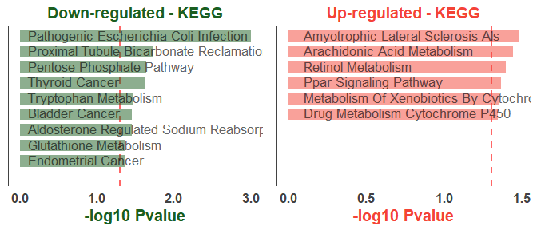<!-- -->

## Sup Figure 6 - DEA Scheme for identification of ovarian metastasis associated DEGs

### DEA Analysis 1 - Ovary Metastasis vs Primary Tumor (as shown in Sup Fig 6A)

``` r
source("./OvaryMetvsPrimaryTumor_DEG_analysis.R")
OvaMetvsPri = run_DEseq2_OvaryMetvsPrimaryTumor(cts = cts, clinData = clinData, excluded_samples)
```

    ## [1] "LOADING DESEQ2 results"
    ## [1] "ANNOTATING DESEQ2 results"

``` r
# SIGNIFICANT DEGS
OvaMetvsPri_sig = subset(OvaMetvsPri, padj < 0.05 & absLogFC >= 1.5)

OvaMetvsPri_sig$ensID = rownames(OvaMetvsPri_sig)

# Supplementary data 3
writexl::write_xlsx(OvaMetvsPri_sig,
                    path = "../output/supplementary_data/Data 3 sheet 2A - Ovary Metastasis vs Primary Tumor.xlsx")
```

``` r
top10_Metup = subset(OvaMetvsPri_sig, log2FoldChange >= 1.5 & padj < 0.001)
top10_Metup = top10_Metup[order(top10_Metup$absLogFC, top10_Metup$log10Padj, decreasing = T),] %>% head(6)

top10_Metdn = subset(OvaMetvsPri_sig, log2FoldChange <= -1.5 & padj < 0.001)
top10_Metdn = top10_Metdn[order(top10_Metdn$absLogFC, top10_Metdn$log10Padj, decreasing = T),] %>% head(6)
```

``` r
# make volcano plot
ggplot(OvaMetvsPri, aes(x = log2FoldChange, y = -log10(padj), color = factor(log2FoldChange>0))) + myTheme + 
  geom_point(alpha = 0.8, aes(size = log10Padj)) + 
  scale_color_manual("Log2 FC",values = c("#1B5E20", "#f44336"), labels = c("Down-regulated", "Up-regulated")) +
  guides(color = guide_legend(override.aes = list(size = 6)), size="none") + xlab("Log2 FC") + 
  geom_hline(yintercept = -log10(0.05), linetype="dashed") +
  geom_vline(xintercept = 1.5, linetype="dashed") + geom_vline(xintercept = -1.5, linetype="dashed") + 
  ggrepel::geom_label_repel(data = rbind(top10_Metup, top10_Metdn), aes(label = Gene), show.legend = F) + 
  annotate(geom = "text", x = 7, y = -4, 
           label= paste0("Up (",as.numeric(table(OvaMetvsPri$log2FoldChange>0)[2]),")"), 
           size = 3.5, fontface="bold",color="darkgray") + 
  annotate(geom = "text", x = -6, y = -4, 
           label= paste0("Down (",as.numeric(table(OvaMetvsPri$log2FoldChange>0)[1]),")"), size = 3.5,
           fontface="bold",color="darkgray") + 
  annotate(geom = "text", x = 7, y = -8, 
           label= paste0("Sig Up (",as.numeric(table(OvaMetvsPri_sig$log2FoldChange>0)[2]),")"),
           size = 3.5,  fontface="bold",color="darkgray") + 
  annotate(geom = "text", x = -6, y = -8, 
           label= paste0("Sig Down (",as.numeric(table(OvaMetvsPri_sig$log2FoldChange>0)[1]),")"), 
           size = 3.5, fontface="bold",color="darkgray") + 
  ylim(c(-10, max(OvaMetvsPri$log10Padj)))
```

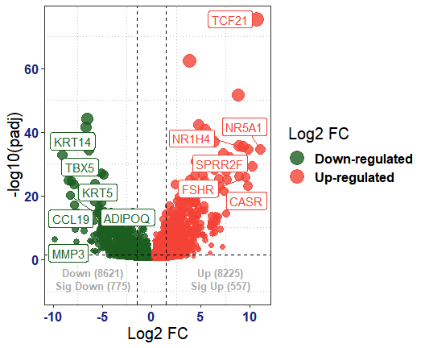<!-- -->

### DEA Analysis 2 - Normal Ovary vs Primary Tumor (as shown in Sup Fig 6A)

``` r
# DEA Analysis 2 (for background correction) - Normal Ovary vs Primary Tumor (as shown in Sup Fig 6A)
source("./OvaryNormalvsPrimaryTumor_DEG_analysis.R")
OvaryVsPri = run_DEseq2_OvaryNormalvsPrimaryTumor(cts, clinData, excluded_samples)
```

    ## [1] "LOADING DESEQ2 results"
    ## [1] "ANNOTATING DESEQ2 results"

``` r
# SIGNIFICANT DEGS
OvaryVsPri_sig = subset(OvaryVsPri, padj < 0.05 & absLogFC >= 1.5)

OvaryVsPri_sig$ensID = rownames(OvaryVsPri_sig)

# Supplementary data 3
writexl::write_xlsx(OvaryVsPri_sig,
                    path = "../output/supplementary_data/Data 3 sheet 2B - Normal Ovary vs Primary Tumor.xlsx")
```

``` r
## Volcano plot - DEG
top10_Ov_up_vsPri = subset(OvaryVsPri_sig, log2FoldChange >= 1.5 & padj < 0.001)
top10_Ov_up_vsPri = top10_Ov_up_vsPri[order(top10_Ov_up_vsPri$absLogFC, top10_Ov_up_vsPri$log10Padj, decreasing = T),] %>% head(5) 

top10_Ov_dn_vsPri = subset(OvaryVsPri_sig, log2FoldChange <= -1.5 & padj < 0.001)
top10_Ov_dn_vsPri = top10_Ov_dn_vsPri[order(top10_Ov_dn_vsPri$absLogFC, top10_Ov_dn_vsPri$log10Padj, decreasing = T),] %>% head(5)
```

``` r
ggplot(OvaryVsPri_sig, aes(x = log2FoldChange, y = -log10(padj), color = factor(log2FoldChange>0), label = Gene)) + myTheme + 
  geom_point(alpha = 0.8, aes(size = log10Padj)) + 
  scale_color_manual("Log2 FC",values = c("#1B5E20", "#f44336"), labels = c("Down-regulated", "Up-regulated")) + 
    guides(color = guide_legend(override.aes = list(size = 6)), size="none") + xlab("Log2 FC") + 
  geom_hline(yintercept = -log10(0.05), linetype="dashed") +
  geom_vline(xintercept = 1.5, linetype="dashed") + geom_vline(xintercept = -1.5, linetype="dashed") + 
  ggrepel::geom_label_repel(data = rbind(top10_Ov_up_vsPri,top10_Ov_dn_vsPri), aes(label = Gene), 
                            nudge_y = 10, nudge_x = 2, show.legend = F) + 
  annotate(geom = "text", x = 9, y = -4, label= paste0("Up (",as.numeric(table(OvaryVsPri$log2FoldChange>0)[2]),")"), 
           size = 3.5, fontface="bold",color="darkgray") + 
  annotate(geom = "text", x = -9, y = -4, label= paste0("Down (",as.numeric(table(OvaryVsPri$log2FoldChange>0)[1]),")"), 
           size = 3.5, fontface="bold",color="darkgray") + 
  annotate(geom = "text", x = 9, y = -10, label= paste0("Sig Up (",as.numeric(table(OvaryVsPri_sig$log2FoldChange>0)[2]),")"),
           size = 3.5, fontface="bold",color="darkgray") + 
  annotate(geom = "text", x = -9, y = -10, label= paste0("Sig Down (",as.numeric(table(OvaryVsPri_sig$log2FoldChange>0)[1]),")"), 
           size = 3.5, fontface="bold",color="darkgray") + 
  ylim(c(-10, max(OvaryVsPri$log10Padj))) + xlim(c(-15, 15))
```

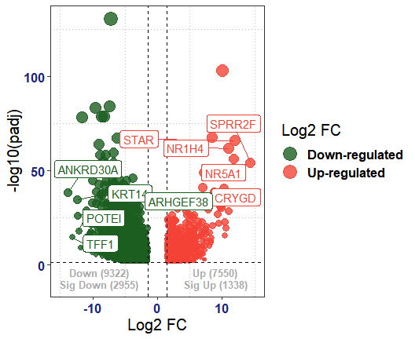<!-- -->

### Sup Fig 6B - Backgroun Correction

``` r
nOvaryvPri_upDEG = subset(OvaryVsPri_sig, log2FoldChange >= 1.5)
nOvaryvPri_dnDEG = subset(OvaryVsPri_sig, log2FoldChange <= -1.5)

ovMetvPri_upDEG = subset(OvaMetvsPri_sig, log2FoldChange >= 1.5)
ovMetvPri_dnDEG = subset(OvaMetvsPri_sig, log2FoldChange <= -1.5)

site_contam_DEGs_UP = intersect(nOvaryvPri_upDEG %>% rownames(), ovMetvPri_upDEG %>% rownames())
site_contam_DEGs_DN = intersect(nOvaryvPri_dnDEG %>% rownames(), ovMetvPri_dnDEG %>% rownames())

length(site_contam_DEGs_DN) # conMet Dn == 645
```

    ## [1] 645

``` r
length(site_contam_DEGs_UP) # conMet Up == 435
```

    ## [1] 435

``` r
site_contam_DEGs = c(site_contam_DEGs_DN, site_contam_DEGs_UP)

site_contam_DEGs_mat = OvaMetvsPri_sig[site_contam_DEGs,]
site_contam_DEGs_mat[site_contam_DEGs, "Ovary_Log2FC"]=OvaryVsPri_sig[site_contam_DEGs, "log2FoldChange"]
site_contam_DEGs_mat[site_contam_DEGs, "Ovary_padj"]=OvaryVsPri_sig[site_contam_DEGs, "padj"]
site_contam_DEGs_mat$label = site_contam_DEGs_mat$Gene

site_contam_df = site_contam_DEGs_mat
dim(site_contam_df)
```

    ## [1] 1080   16

``` r
# plot(density(site_contam_df$log2FoldChange-site_contam_df$Ovary_Log2FC))
site_contam_df$diff = site_contam_df$log2FoldChange-site_contam_df$Ovary_Log2FC
cutoff = 0.5
```

### CORRECTION OF UP REGULATED DEGs

``` r
site_contam_df_UP = subset(site_contam_df, log2FoldChange > 0)
dim(site_contam_df_UP)
```

    ## [1] 435  17

``` r
site_contam_df_UP$up_in = ifelse(site_contam_df_UP$diff >= cutoff, "Met", "background")

supFig6B_1 = ggplot(site_contam_df_UP, aes(log2FoldChange, Ovary_Log2FC, color = up_in, size = abs(diff)))+geom_point(alpha = 0.6)+
  myTheme + xlab("LFC Ovary Metastasis") + ylab("LFC Normal Ovary") + 
  ggrepel::geom_label_repel(data = subset(site_contam_df_UP[order(site_contam_df_UP$diff, decreasing = T),], 
                                          up_in %in% "Met") %>% head(6), 
                            nudge_x = 2,nudge_y = -1, aes(label = label), show.legend = F, size = 3.5) + 
  ggrepel::geom_label_repel(force = T, data = subset(site_contam_df_UP[order(site_contam_df_UP$diff, decreasing = F),], 
                                                     up_in %in% "background") %>% head(6), 
                            nudge_x = -2,nudge_y = 2, aes(label = label), show.legend = F, size = 3.5)+
  geom_abline(intercept = 0, slope = 1,  alpha = 0.5, linetype="dashed") +
  geom_abline(intercept = -cutoff, slope = 1,  linetype="dashed", color="red") + ylim(c(0,15)) + xlim(c(0,15)) + 
  scale_color_manual("Up in",values = c("#1B5E20", "#f44336"), labels = c("Normal Ovary", "Ovary Metastasis")) + 
  scale_size(expression(Delta * ' LFC'))
```

``` r
print(paste0(table(site_contam_df_UP[!duplicated(site_contam_df_UP$Gene), "up_in"])[1], "/", 
             sum(table(site_contam_df_UP[!duplicated(site_contam_df_UP$Gene), "up_in"])),
       " were background genes"))
```

    ## [1] "408/435 were background genes"

### CORRECTION OF DOWN REGULATED DEGs

``` r
cutoff = 0.5
site_contam_df_DN = subset(site_contam_df, log2FoldChange < 0)
dim(site_contam_df_DN)
```

    ## [1] 645  17

``` r
site_contam_df_DN$dn_in = ifelse(site_contam_df_DN$diff < -cutoff, "Met", "background")
table(site_contam_df_DN$dn_in)
```

    ## 
    ## background        Met 
    ##        601         44

``` r
supFig6B_2 = ggplot(site_contam_df_DN, aes(log2FoldChange, Ovary_Log2FC, color = dn_in, size = abs(diff)))+geom_point(alpha = 0.6)+
  myTheme + xlab("LFC Ovary Metastasis") + ylab("LFC Normal Ovary") + 
  ggrepel::geom_label_repel(data = subset(site_contam_df_DN[order(site_contam_df_DN$diff, decreasing = F),], 
                                          dn_in %in% "Met") %>% head(6), 
                            nudge_x = 1,nudge_y = -0.5, aes(label = label), show.legend = F, size = 3.5) + 
  ggrepel::geom_label_repel(data = subset(site_contam_df_DN[order(site_contam_df_DN$diff, decreasing = T),], 
                                          dn_in %in% "background") %>% head(6), 
                            nudge_x = -1,nudge_y = 0.25, aes(label = label), show.legend = F, size = 3.5)+
  geom_abline(intercept = 0, slope = 1,  alpha = 0.5, linetype="dashed")+
  geom_abline(intercept = -cutoff, slope = 1,  linetype="dashed", color="red") + ylim(c(0,-12.5)) + xlim(c(0,-12.5)) + 
  scale_color_manual("Dn in",values = c("#1B5E20", "#f44336"), labels = c("Normal Ovary", "Ovary Metastasis")) + scale_size(expression(Delta * ' LFC'))
```

``` r
print(paste0(table(site_contam_df_DN[!duplicated(site_contam_df_DN$Gene), "dn_in"])[1], "/", 
             sum(table(site_contam_df_DN[!duplicated(site_contam_df_DN$Gene), "dn_in"])),
       " were background genes"))
```

    ## [1] "601/645 were background genes"

``` r
ggarrange(plotlist = list(supFig6B_1, supFig6B_2))
```

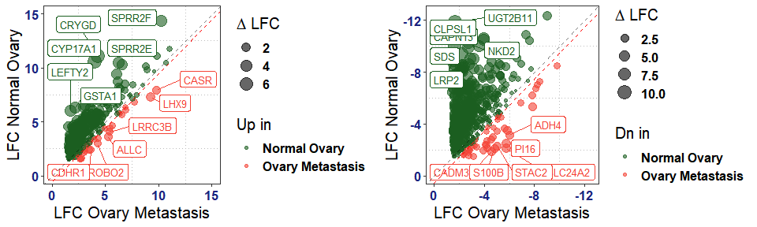<!-- -->
### REMOVE BACKGROUND CONTAMINCATIONS

``` r
OvaMetvsPri_corrected = subset(OvaMetvsPri, 
                                   Gene %notin% c(site_contam_df_DN[site_contam_df_DN$dn_in %in% "background","Gene"],
                                                  site_contam_df_UP[site_contam_df_UP$up_in %in% "background","Gene"]))

OvaMetvsPri_sig_corrected = subset(OvaMetvsPri_sig, 
                                   Gene %notin% c(site_contam_df_DN[site_contam_df_DN$dn_in %in% "background","Gene"], 
                                                  site_contam_df_UP[site_contam_df_UP$up_in %in% "background","Gene"]))

OvaMetvsPri_sig_corrected$ensID = rownames(OvaMetvsPri_sig_corrected)

# Supplementary data 2
writexl::write_xlsx(OvaMetvsPri_sig_corrected,
                    path = "../output/supplementary_data/Data 3 sheet 2C - Bg Corrected Ovary Metastasis vs Primary Tumor.xlsx")
```

## Figure 4 - Identification of drivers of ovarian metastasis and CASR upregulation

### Fig 4A - Volcano Plot of Corrected Ovary Metastasis Assocated DEGs

``` r
top10_Metup = subset(OvaMetvsPri_sig_corrected, log2FoldChange >= 1.5 & padj < 0.001)
top10_Metup = top10_Metup[order(top10_Metup$absLogFC, top10_Metup$log10Padj, decreasing = T),] %>% head(6)

top10_Metdn = subset(OvaMetvsPri_sig_corrected, log2FoldChange <= -1.5 & padj < 0.001)
top10_Metdn = top10_Metdn[order(top10_Metdn$absLogFC, top10_Metdn$log10Padj, decreasing = T),] %>% head(6)
```

``` r
# make volcano plot
fig4A = ggplot(OvaMetvsPri_corrected, aes(x = log2FoldChange, y = -log10(padj), color = factor(log2FoldChange>0))) + myTheme + 
  geom_point(alpha = 0.8, aes(size = log10Padj)) + 
  scale_color_manual("Log2 FC",values = c("#1B5E20", "#f44336"), labels = c("Down-regulated", "Up-regulated")) +
  guides(color = guide_legend(override.aes = list(size = 6)), size="none") + xlab("Log2 FC") + 
  geom_hline(yintercept = -log10(0.05), linetype="dashed") +
  geom_vline(xintercept = 1.5, linetype="dashed") + geom_vline(xintercept = -1.5, linetype="dashed") + 
  ggrepel::geom_label_repel(data = rbind(top10_Metup, top10_Metdn), aes(label = Gene), show.legend = F) + 
  annotate(geom = "text", x = 7, y = -2, 
           label= paste0("Up (",as.numeric(table(OvaMetvsPri_corrected$log2FoldChange>0)[2]),")"), 
           size = 3.5, fontface="bold",color="darkgray") + 
  annotate(geom = "text", x = -6, y = -2, 
           label= paste0("Down (",as.numeric(table(OvaMetvsPri_corrected$log2FoldChange>0)[1]),")"), size = 3.5,
           fontface="bold",color="darkgray") + 
  annotate(geom = "text", x = 7, y = -4, 
           label= paste0("Sig Up (",as.numeric(table(OvaMetvsPri_sig_corrected$log2FoldChange>0)[2]),")"),
           size = 3.5,  fontface="bold",color="darkgray") + 
  annotate(geom = "text", x = -6, y = -4, 
           label= paste0("Sig Down (",as.numeric(table(OvaMetvsPri_sig_corrected$log2FoldChange>0)[1]),")"), 
           size = 3.5, fontface="bold",color="darkgray") + 
  ylim(c(-5, max(OvaMetvsPri_corrected$log10Padj)))
```

``` r
fig4A
```

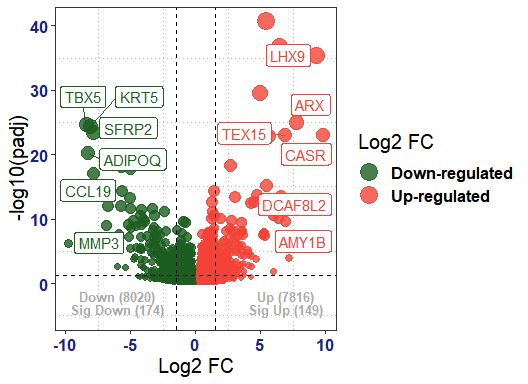<!-- -->

### Fig 4B - Heatmap of Corrected Ovary Metastasis DEGs

``` r
# Clinical Cohort
clinData_select = subset(clinData, Subtype %in% c("IDC","ILC","mDLC") & 
                             Study_Code %in% "Ovary" &  SampleID %notin% excluded_samples)
dim(clinData_select)
```

    ## [1] 38 14

``` r
clinData_Pri = subset(clinData_select, TissueType %in% "Primary")
clinData_Met = subset(clinData_select, TissueType %in% "Metastasis")

cts_log2CPM = getCPM(cts, logged = T)
```

``` r
makeDEG_Heatmap = function(DEG_df, clinData_select, show_row_names = F){
  ## DEG PLOT
  rowTitle = paste0(c("Metastasis\nDn (N=","Metastasis\nUp (N="), table(DEG_df$log2FoldChange > 0),c(")",")"))
  
  colTitle = paste0(c("Primary\n(N=","Metastasis\n(N="), as.character(rev(table(clinData_select$TissueType))), c(")",")"))
  colTitle = factor(colTitle, level = rev(levels(as.factor(colTitle))))
  
  mat_exp = cts_log2CPM[DEG_df %>% rownames(), clinData_select$SampleID]
  rownames(mat_exp) = pcGeneMap[rownames(mat_exp), "external_gene_name"]
  
  mat_exp_zscore = t(scale(t(mat_exp))) # z-scoring
  
  cols = c('green','black','red')
  colFun = circlize::colorRamp2(c(-2,0,2), cols, space = 'RGB')
  
  set.seed(123); deg_ht = Heatmap(mat_exp_zscore, col = colFun, column_km = 2, row_title = rev(rowTitle), 
                                column_title = " ",
                                row_split = ifelse(DEG_df$log2FoldChange > 0, "Met Up","Met Dn"),
                                show_column_names = F, show_row_names = F, 
                                row_names_gp = gpar(fontsize = 10, fontface="bold"), name="Normalized Exp",
                                top_annotation = HeatmapAnnotation(annotation_name_side = "left",
                                                                   Subtype = clinData_select$Subtype, 
                                                                   ER = clinData_select$ER_infered, 
                                                                   annotation_name_gp = gpar(fontsize = 10, 
                                                                                             fontface="bold", col="#616161"),
                                                                   `Tissue Type` = clinData_select$TissueType,
                                                                   PAM50 = clinData_select$PAM50, col = annot_col))
  
  OvM_LFC = OvaMetvsPri[DEG_df %>% rownames(),"log2FoldChange"]
  OvM_LFC[is.na(OvM_LFC)]=0
  nOv_LFC = OvaryVsPri[DEG_df %>% rownames(),"log2FoldChange"]
  nOv_LFC[is.na(nOv_LFC)]=0
  rightMat = OvM_LFC - nOv_LFC
  
  rightMat = as.matrix(as.data.frame(rightMat))
  rownames(rightMat)=DEG_df %>% rownames()
  colnames(rightMat)=c("Log2FC")
  rownames(rightMat)=pcGeneMap[rownames(rightMat), "external_gene_name"]
  set.seed(123); right_HT = Heatmap(rightMat, col = colFun, column_names_side = "top", 
                                    column_names_gp = gpar(fontsize = 12, fontface="bold"),
                                    show_column_dend = F, show_row_names = show_row_names, name = "log2-FC",
                                    row_names_gp = gpar(fontsize = 10, fontface="bold"))
  return(list(deg_ht = deg_ht, right_HT = right_HT))
}
```

``` r
OvaMet_sigDEG_Ht = makeDEG_Heatmap(DEG_df = OvaMetvsPri_sig_corrected, clinData_select = clinData_select, show_row_names = F)
draw(OvaMet_sigDEG_Ht$deg_ht + OvaMet_sigDEG_Ht$right_HT, merge_legend = TRUE, heatmap_legend_side = "right")
```

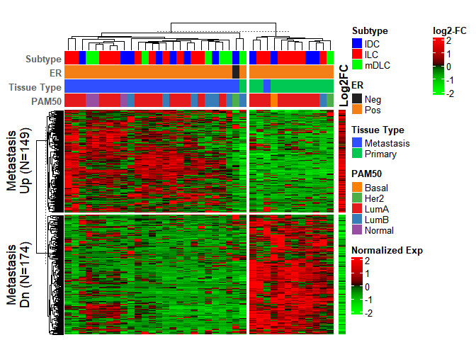<!-- -->

``` r
# Add statistics to df - selecting top genes based on effect size
OvaMetvsPri_sig_corrected$meanExp_Pri = apply(cts_log2CPM[rownames(OvaMetvsPri_sig_corrected), clinData_Pri$SampleID], 1, mean)
OvaMetvsPri_sig_corrected$meanExp_Met = apply(cts_log2CPM[rownames(OvaMetvsPri_sig_corrected), clinData_Met$SampleID], 1, mean)

OvaMetvsPri_sig_corrected$meanExp_diff = OvaMetvsPri_sig_corrected$meanExp_Met-OvaMetvsPri_sig_corrected$meanExp_Pri

# Sorted by log2FC and padj
OvaMetvsPri_sig_corrected = OvaMetvsPri_sig_corrected[order(OvaMetvsPri_sig_corrected$absLogFC, 
                                                    OvaMetvsPri_sig_corrected$log10Padj,decreasing = T),]

cols_interest = c("log2FoldChange","padj","Gene","meanExp_diff","meanExp_Pri","meanExp_Met")
OvaMetvsPri_sig_corrected_UP = subset(OvaMetvsPri_sig_corrected, log2FoldChange >= 1.5)[,cols_interest]
OvaMetvsPri_sig_corrected_UP[order(OvaMetvsPri_sig_corrected_UP$log2FoldChange, decreasing = T),] %>% head()
```

    ##                 log2FoldChange                                      padj
    ## ENSG00000036828          9.826 0.000000000000000000000011051962893127113
    ## ENSG00000143355          9.299 0.000000000000000000000000000000000003437
    ## ENSG00000004848          7.703 0.000000000000000000000000082242895498834
    ## ENSG00000174876          7.205 0.000126335720766419058519111628946518522
    ## ENSG00000133863          6.922 0.000000000000000000000010255777992438132
    ## ENSG00000189186          6.922 0.000000000260984500707600642894871956212
    ##                    Gene meanExp_diff meanExp_Pri meanExp_Met
    ## ENSG00000036828    CASR       3.6618     0.05320      3.7150
    ## ENSG00000143355    LHX9       2.9649     0.09604      3.0610
    ## ENSG00000004848     ARX       4.6646     0.64912      5.3138
    ## ENSG00000174876   AMY1B       0.2266     0.12323      0.3498
    ## ENSG00000133863   TEX15       1.8734     0.08247      1.9558
    ## ENSG00000189186 DCAF8L2       1.0926     0.03234      1.1249

``` r
OvaMetvsPri_sig_corrected_DN = subset(OvaMetvsPri_sig_corrected, log2FoldChange <= -1.5)[,cols_interest]
OvaMetvsPri_sig_corrected_DN[order(OvaMetvsPri_sig_corrected_DN$log2FoldChange, decreasing = F),] %>% head()
```

    ##                 log2FoldChange                           padj   Gene
    ## ENSG00000149968         -9.822 0.0000005007375273606219463415   MMP3
    ## ENSG00000089225         -8.447 0.0000000000000000000000002284   TBX5
    ## ENSG00000181092         -8.267 0.0000000000000000000069100234 ADIPOQ
    ## ENSG00000186081         -8.093 0.0000000000000000000000004170   KRT5
    ## ENSG00000172724         -7.872 0.0000000000000000081196460606  CCL19
    ## ENSG00000145423         -7.871 0.0000000000000000000000033987  SFRP2
    ##                 meanExp_diff meanExp_Pri meanExp_Met
    ## ENSG00000149968       -3.553       3.614     0.06057
    ## ENSG00000089225       -3.096       3.288     0.19226
    ## ENSG00000181092       -2.882       2.979     0.09750
    ## ENSG00000186081       -6.065       7.006     0.94157
    ## ENSG00000172724       -2.650       2.965     0.31502
    ## ENSG00000145423       -5.711       6.737     1.02559

``` r
# Identify cutoffs for identifying outlier DEGs --> Top significant DEGs
#plot(density(OvaMetvsPri_sig_corrected$meanExp_diff))
mean(OvaMetvsPri_sig_corrected$meanExp_diff)+2*sd(OvaMetvsPri_sig_corrected$meanExp_diff) -> met_diff_cutoff
mean(OvaMetvsPri_sig_corrected$meanExp_diff)-2*sd(OvaMetvsPri_sig_corrected$meanExp_diff) -> pri_diff_cutoff

# Top significant DEG dataframe
top_sig_DEGs_df = rbind(subset(OvaMetvsPri_sig_corrected_UP, meanExp_diff >= met_diff_cutoff),
                    subset(OvaMetvsPri_sig_corrected_DN, meanExp_diff <= pri_diff_cutoff))
```

### Fig 4C - IPA Pathway Analysis Plot

``` r
# Corrected Ovary Metastasis vs Primary Tumor Significant DEGs were input to IPA to generate following analysis output
IPA_out = read.delim("../input/OvaryMetvsPri_Sig_DEG_only_PathwayActivity.txt", skip = 2)

IPA_out = IPA_out[,-6]

names(IPA_out)=c("label","logpval","Overlap Ratio","z-score","Hits")
IPA_out$label[2]="alpha-tocopherol Degradation" # replace symbol with proper name - creates issue in plotting fig
df = IPA_out

df$abr_label = abbreviate(df[,"label"], minlength = 50)
df = df[order(df[,"logpval"], decreasing = T),]

### REMOVE NAN IN ACTIVATION SCORE
df = df[!is.nan(df$`z-score`), ]
df_pos = subset(df, `z-score` > 0)
df_neg = subset(df, `z-score` < 0)

df = rbind(head(df_pos,5), head(df_neg,5))

### TOP SELECTION
plot_top_n = 10
df_sub=(df[1:plot_top_n,])
hide_NA = NULL
if (nrow(df_sub) < plot_top_n){
  pad_length = plot_top_n-nrow(df_sub)
  padding = as.data.frame(matrix(data = NA, nrow = pad_length, ncol = ncol(df_sub)))
  colnames(padding)=colnames(df_sub)
  padding$logpval = 0
  padding$abr_label = as.character(1:pad_length)
  hide_NA = theme(axis.text.x = element_text(colour = c(rep("#424242", nrow(df_sub)), rep("#FAFAFA", pad_length))))
  df_sub = rbind(df_sub, padding)
}
geomVline = geom_vline(xintercept = -log10(0.05), linetype='dashed', color="red", alpha = 0.6, size = 1)

title_color="#0097A7"; font_color="black"; bar_color="#80DEEA"
title="IPA Pathways"
```

``` r
fig4C = ggplot(df_sub, aes(y = reorder(abr_label, logpval), x = logpval, label = label)) +geomVline+
  geom_bar(stat = "identity", aes(fill=`z-score`), alpha = 0.5,width = 0.75) + myTheme_barplot + 
  geom_text(aes(x = 0.1), size = 5, face="bold", hjust = 0, vjust = 0.35, alpha = 0.6, color = font_color) + 
  scale_x_continuous(expand = c(0, 0.2))+theme(title = element_text(size = 12, color = title_color))+
  scale_fill_gradient2("", low = "#1B5E20",mid = "white",midpoint = 0, high = c("#f44336"),
                       breaks = c(1.15,-0.75),labels = c("Up-regulated","Down-regulated"))+
  scale_x_continuous(labels = function(x) sprintf("%.1f", x)) + hide_NA +
  theme(axis.title.x = element_text(size = 14), legend.position = "right")+xlab("-log10 Pval")
```

``` r
fig4C
```

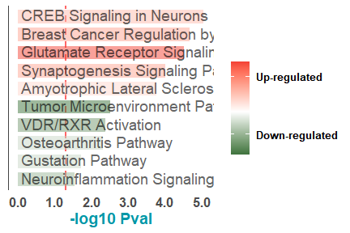<!-- -->

### Fig 4D - GSVA Scoring of Gulatamate Receptor Pathway

``` r
# Glutamate signaling genesets from "Synaptic proximity enables NMDAR signalling to promote brain metastasis" - Pubmed: 31534217
kainate_receptor = c("GRIK1", "GRIK2", 'GRIK3', "GRIK4", "GRIK5")
metabotropic_receptor = c("GRM1", 'GRM2', 'GRM3', "GRM4", 'GRM5', "GRM6", "GRM7", "GRM8")

glutamate_receptor_sig = list(`Kainate Receptor`=kainate_receptor, `Metabotropic Receptor` = metabotropic_receptor)


# GSVA scoring -- Do Not Run again
# library(GSVA)
# set.seed(123); glutamate_gsva = gsva(expr = log2_tpm_genes[, clinData_select$SampleID], 
#                gset.idx.list = glutamate_receptor_sig,
#                method="gsva", kcdf="Poisson", parallel.sz = 4)
# icesTAF::mkdir("../output/pathway_analysis/gsva/")
# save(glutamate_gsva, file = "../output/pathway_analysis/gsva/glutamate_gsva.Rdata")

load(file = "../output/pathway_analysis/gsva/glutamate_gsva.Rdata")
```

``` r
kainate_gsva = mkDF_scores(scoreMat = glutamate_gsva, signature = "Kainate Receptor", clinData = clinData_select)

fig4D_1 = ggplot(kainate_gsva, aes(TissueType, score, label = SampleIDs)) + ## AES
  geom_boxplot(na.rm = T, outlier.colour = NA, alpha = 0.5, fill="gray",color="gray") + ## BOXPLOT
  geom_point(size = 2.5, shape = 21, aes(shape = TissueType), alpha = 0.6)+  ## POINTS
  geom_line(aes(group = Group, color = Subtype), size = 1, alpha = 0.7) +
  ylab("GSVA score\nKainate Receptor") +  xlab("") +  ## ADD N
  stat_compare_means(comparisons = combn(unique(as.character(kainate_gsva$TissueType)),m = 2, simplify = F),
                     label = "p.signif", size = 5, vjust = 1.4, color="red", method = "wilcox.test", 
                     label.x.npc =0.5)+  ## STATISTICS
  scale_color_manual("Histology",values = c("blue","red","green","gray")) + 
  myTheme + theme(axis.text.x = element_text(angle = 0))
```

``` r
metabotrophic_gsva = mkDF_scores(scoreMat = glutamate_gsva, signature = "Metabotropic Receptor", clinData = clinData_select)

fig4D_2 = ggplot(metabotrophic_gsva, aes(TissueType, score, label = SampleIDs)) + ## AES
  geom_boxplot(na.rm = T, outlier.colour = NA, alpha = 0.5, fill="gray",color="gray") + ## BOXPLOT
  geom_point(size = 2.5, shape = 21, aes(shape = TissueType), alpha = 0.6)+  ## POINTS
  geom_line(aes(group = Group, color = Subtype), size = 1, alpha = 0.7) +
  ylab("GSVA score\nMetabotropic Receptor") +  xlab("") +  ## ADD N
  stat_compare_means(comparisons = combn(unique(as.character(metabotrophic_gsva$TissueType)),m = 2, simplify = F),
                     label = "p.signif", size = 5, vjust = 1.4, color="red", method = "wilcox.test", 
                     label.x.npc =0.5)+  ## STATISTICS
  scale_color_manual("Histology",values = c("blue","red","green","gray")) + 
  myTheme + theme(axis.text.x = element_text(angle = 0))
```

``` r
ggarrange(plotlist = list(fig4D_2, fig4D_1))
```

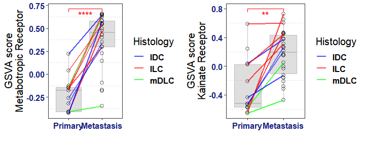<!-- -->

### Fig 4E - Heatmap of Top Significant DEGs associated with Ovarian Metastasis

``` r
OvaMet_TOP_sigDEG_Ht = makeDEG_Heatmap(DEG_df = top_sig_DEGs_df, clinData_select = clinData_select, show_row_names = T)
draw(OvaMet_TOP_sigDEG_Ht$deg_ht + OvaMet_TOP_sigDEG_Ht$right_HT, merge_legend = TRUE, heatmap_legend_side = "right")
```

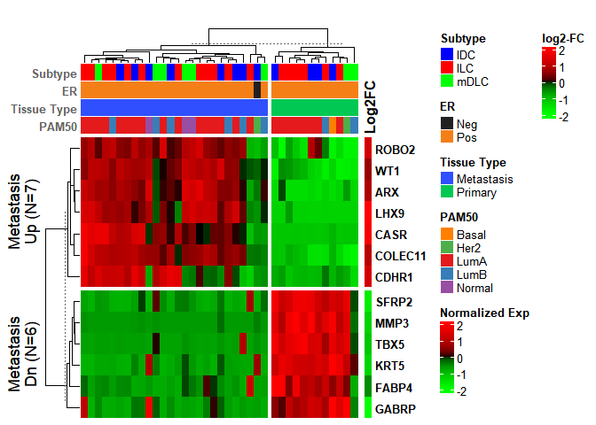<!-- -->

### Fig 4F - CASR Gene Expression

``` r
gene = "CASR"
casr_df = mkDF(gene, clinData_select)

# Fix connections between primary samples with multiple matched metastasis
casr_df$Group = as.character(casr_df$Group)
ov11_pri = casr_df[casr_df$Group %in% "Ov11" & casr_df$TissueType %in% "Primary",]
ov11_pri = rbind(ov11_pri, ov11_pri)
ov11_pri$Group = paste0(ov11_pri$Group, c("a", "b"))
casr_df = casr_df[!(casr_df$Group %in% "Ov11" & casr_df$TissueType %in% "Primary"),]
casr_df = rbind(casr_df, ov11_pri)
casr_df[casr_df$Group %in% "Ov11" & casr_df$TissueType %in% "Metastasis","Group"] = paste0(casr_df[casr_df$Group %in% "Ov11" & casr_df$TissueType %in% "Metastasis","Group"], c("a","b"))

casr_df[casr_df$Group %in% "Ov14" & casr_df$TissueType %in% "Metastasis","Group"] = paste0(casr_df[casr_df$Group %in% "Ov14" & casr_df$TissueType %in% "Metastasis","Group"], c("a","b"))

casr_df$TissueType = factor(casr_df$TissueType, level = c("Primary", "Metastasis"))

fig4F_1 = ggplot(casr_df, aes(TissueType, geneLog2TPM, label = SampleIDs)) + ## AES
  geom_boxplot(na.rm = T, outlier.colour = NA, alpha = 0.5, fill="gray",color="gray") + ## BOXPLOT
  geom_point(size = 2.5, aes(shape = Paired), alpha = 0.6)+  ## POINTS
  geom_line(aes(group = Group, color = Subtype), size = 1, alpha = 0.7) + xlab("") +  
  ylab(paste0("Log2 Expression")) + scale_y_continuous(labels = scales::number_format(accuracy = 1)) +  ## YLAB
  stat_compare_means(comparisons = combn(unique(as.character(casr_df$TissueType)),m = 2, simplify = F),
                     label = "p.signif", size = 5, vjust = 1.4, color="red", method = "wilcox.test", 
                     label.x.npc =0.5) +  ## STATISTICS
  scale_color_manual("Subtype",values = c("blue","red","green")) + myTheme
```

``` r
# CASR Expression across various BC metastasis sites
gene = "CASR"
clinData_mets = subset(clinData, TissueType %in% "Metastasis" & Subtype %in% c("IDC","ILC","mDLC") & 
                                 SampleID %notin% excluded_samples)

casr_df = mkDF(gene, clinData_mets)

fig4F_2 = ggplot(casr_df, aes(Site, geneLog2TPM, label = SampleIDs)) + ## AES
  geom_boxplot(na.rm = T, outlier.colour = NA, alpha = 0.5, fill="gray",color="gray") + ## BOXPLOT
  ggbeeswarm::geom_quasirandom(aes(color = Subtype), size = 4)+
  ylab(paste0("Log2 Expression")) +  ## YLAB
  stat_n_text() + xlab("Metastasis Sites") +  ## ADD N
  stat_compare_means(comparisons = combn(unique(as.character(casr_df$Site)),m = 2, simplify = F)[1:3],
                     label = "p.signif", size = 5, vjust = 1.4, color="red", method = "wilcox.test", label.x.npc =0.5) +  
  scale_color_manual("Subtype",values = c("blue","red","green","gray")) + myTheme
```

``` r
ggarrange(plotlist = list(fig4F_1, fig4F_2))
```

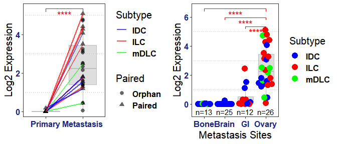<!-- -->

# …………………………………………………………………………….

# B. DNAseq

``` r
source("./preparation/c.prepare_DNAseq_mat.R")

clinData_select = subset(clinData, Subtype %in% c("IDC","ILC","mDLC") & Study_Code %in% "Ovary")
snv_list = load_filter_SNVs(clinData = clinData_select)

# Supplementary data 1
writexl::write_xlsx(snv_list$filtered_SNVs[, -c(1,2,3,4)], 
                    path = "../output/supplementary_data/Data 1 sheet 1 - Cravat Annotated Mutations.xlsx")
```

## Sup Figure 2 - MammaSeq based DNAseq QC

``` r
load("../input/TarSeqQC_summary_df.Rdata")

coverages=tarSeqQC_df[,grep(x=names(tarSeqQC_df), pattern = "coverage", value = T)]
colnames(coverages)=gsub(x=colnames(coverages), pattern = "coverage_",replacement = "")
colnames(coverages)=gsub(x=colnames(coverages), pattern = "[.]",replacement = "-")

sampleIDs = colnames(coverages)
colnames(coverages) = gsub(x = clinData[colnames(coverages), "SimpleID"], pattern = "M_1", replacement = "M1")
colnames(coverages) = gsub(x = colnames(coverages), pattern = "M_2", replacement = "M2")
colnames(coverages) = gsub(x = colnames(coverages), pattern = "_", replacement = " ")

coverages_log2 = as.matrix(log2(coverages+1))
```

### Sup Fig 2A - Pool Coverage

``` r
library(ComplexHeatmap)

cols=c('red','green')
colFun=circlize::colorRamp2(c( log2(10+1), log2(1000+1) ), cols, space = 'RGB')


set.seed(123); supFig2a = Heatmap(matrix = t(coverages_log2), col = colFun, row_names_gp = gpar(fontsize=10, fontface="bold"),
                       name = "Log2 Coverage", column_order = tarSeqQC_df$ProbeID,
                       column_split = tarSeqQC_df$pool, column_title = c("Pool 1\nProbes", "Pool 2\nProbes"),
                       row_split = factor(clinData[sampleIDs, "TissueType"], levels = c("Metastasis","Primary","Normal")),
                       cluster_columns = F, cluster_rows = F, use_raster = T, show_row_names = T, show_column_names = F)
```

``` r
supFig2a
```

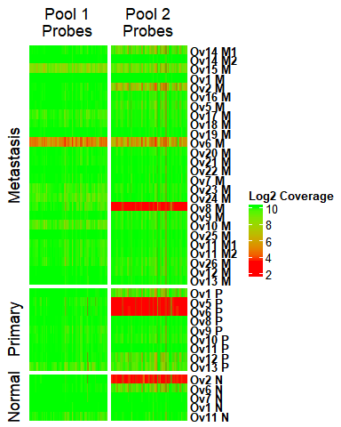<!-- -->

### Sup Fig 2B - Overall Coverage

``` r
coverage_df = as.data.frame(apply(coverages, 2, mean))
names(coverage_df) = "Coverage"
coverage_df$ID = rownames(coverage_df)
coverage_df$TissueType = clinData[sampleIDs, "TissueType"]

supFig2b = ggplot(coverage_df, aes(x = reorder(ID, Coverage), y = Coverage, fill = TissueType, group = TissueType)) + 
  geom_bar(stat = "identity") + myTheme + theme(axis.text.x = element_text(angle = 90,size = 10), 
                                                axis.text.y = element_text(size = 10)) + xlab("") + coord_flip(expand = T)+
  scale_y_log10() +  #theme(plot.margin = margin(0.5,1,0,0,"cm")) + 
  scale_fill_manual("Tissue\nType", values = c("Primary" = "#00C853", "Metastasis" = "#304FFE", "Normal" = "gray"))
```

``` r
supFig2b
```

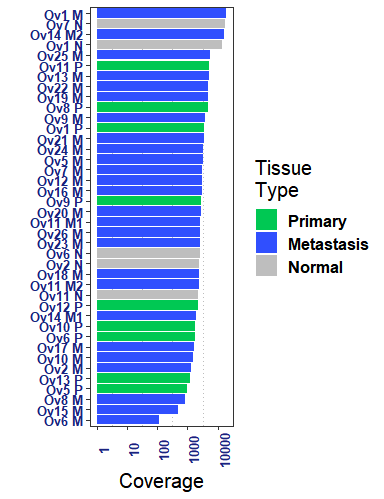<!-- -->

### Sup Fig 2C - SNV Count Before/After Filtering

``` r
snv.before.filtering = as.data.frame(table(snv_list$unfiltered_SNVs$Sample.ID))
snv.before.filtering = snv.before.filtering[order(snv.before.filtering$Freq, decreasing = T),]
rownames(snv.before.filtering) = as.character(snv.before.filtering$Var1)

snv.after.filtering = as.data.frame(table(snv_list$filtered_SNVs$Sample.ID))
snv.after.filtering = snv.after.filtering[order(snv.after.filtering$Freq, decreasing = T),]
rownames(snv.after.filtering) = as.character(snv.after.filtering$Var1)
snv.after.filtering = snv.after.filtering[as.character(snv.before.filtering$Var1),]
snv.after.filtering$Var1 = snv.before.filtering$Var1
snv.after.filtering$Freq[is.na(snv.after.filtering$Freq)]=0

combined.snv.dist = t(merge(x = snv.before.filtering, y = snv.after.filtering, by = "Var1"))
colnames(combined.snv.dist) = combined.snv.dist[1,]
combined.snv.dist = combined.snv.dist[-1,]
rownames(combined.snv.dist) = c("SNV Count Before Filtering", "SNV Count After Filtering")
rnames = rownames(combined.snv.dist)
cnames = colnames(combined.snv.dist)
combined.snv.dist = apply(combined.snv.dist, 2, as.numeric)
colnames(combined.snv.dist) = cnames
rownames(combined.snv.dist) = rnames
combined.snv.dist = as.data.frame(t(combined.snv.dist))
combined.snv.dist = as.matrix(t(combined.snv.dist[order(combined.snv.dist$`SNV Count Before Filtering`,decreasing = T),]))

melt_df = melt(combined.snv.dist)
melt_df$Var1 = factor(melt_df$Var1, labels = (c("Before Filtering","After Filtering")))
melt_df$Var2 = as.character(melt_df$Var2)

melt_df$Var2 = gsub(x = clinData[melt_df$Var2, "SimpleID"], pattern = "M_1", replacement = "M1")
melt_df$Var2 = gsub(x = melt_df$Var2, pattern = "M_2", replacement = "M2")
melt_df$Var2 = gsub(x = melt_df$Var2, pattern = "_", replacement = " ")

supFig2c = ggplot(melt_df, aes(reorder(Var2,value), value, fill = Var1)) + geom_bar(position = "stack", stat = "identity")+myTheme+scale_fill_manual("SNV Count", values = rev(c("darkblue", "red"))) + xlab("")+ ylab("SNV Count") + coord_flip() + 
  theme(axis.text.x = element_text(angle = 90, size = 10)) + theme(legend.position = c(0.55, 0.2))
```

``` r
supFig2c
```

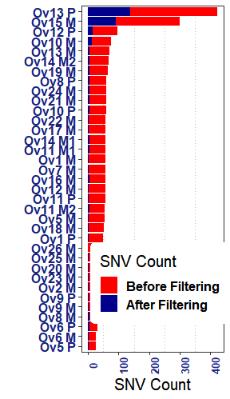<!-- -->

## Figure 2 - Mutational Landscape of ovarian metastasis cohort

``` r
# paired samples
commonSamples = intersect(clinData$SampleID, snv_list$filtered_SNVs$Sample.ID %>% unique())
paired_boolean = table(clinData[commonSamples,]$Patient_ID, clinData[commonSamples,]$TissueType)
paired_patients = names(which(paired_boolean[,1] > 0 & paired_boolean[,2] > 0))
clinData_paired = subset(clinData[commonSamples,], Patient_ID %in% paired_patients)
```

### Fig 2A - Mutational Frequency Changes in Paired Samples

``` r
mutational_change_paired = mutational_changes(snv_list, clinData = clinData_paired)

cols = annot_col$`Tissue Type`[1:2]
names(cols)=c("Pri Up", "Met Up")

fig2a = ggplot(mutational_change_paired, aes(x = genes, y = factor(variable), fill = value)) + 
  geom_tile(alpha = 0.5, show.legend = T, color="black") + 
  scale_fill_gradient("% of samples\nwith mutations", low = "#FAFAFA", high = "#b71c1c", labels = scales::label_number(1)) + 
    myTheme+xlab("")+ylab("")+geom_text(show.legend = F,fontface="bold", aes(label = round(value,1))) +
    coord_flip() + blankTheme + theme(axis.text.x = element_text(color = c(cols)), 
                                      axis.text.y = element_text(color = cols[mutational_change_paired$change_type]))+
    scale_color_manual("Change Type", values = cols) + guides(size = FALSE, color = FALSE) + theme(legend.position = "top")
```

``` r
fig2a
```

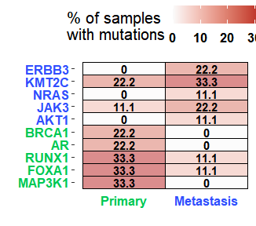<!-- -->

### Fig 2B - Oncoprint

``` r
SNV_mat_paired = prepare_SNV_matrix(snv_list$filtered_SNVs, clinData_paired)
fig_2B = generate_oncoprint(split_by = c("Subtype","Patient_ID"), clinData = clinData_paired, mat.list.uni = SNV_mat_paired, n_genes = 5)
draw(fig_2B, merge_legend = TRUE, heatmap_legend_side = "right")
```

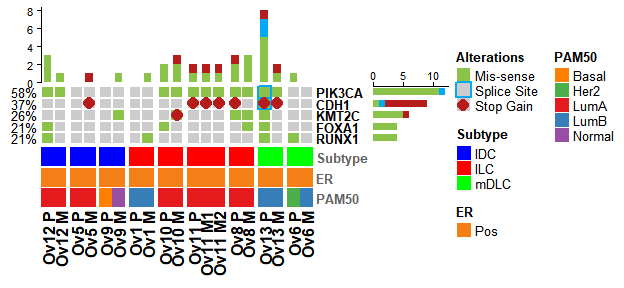<!-- -->

### Fig 2D - Nanostring Copy Number

``` r
source("./preparation/d.prepare_cnv_data.R")
CNV_mat = process_CNV_data()
table(clinData_select[colnames(CNV_mat), "TissueType"])
```

    ## 
    ## Metastasis    Primary 
    ##         23          6

``` r
# HEATMAP
library(ComplexHeatmap)

# CN level colors
colFun3 = c("AMP" = "red", "GAIN" = "#F06292", "WT" = "lightgray", "LOH" = "#64B5F6", "DEL" = "#0D47A1")

# Chromosome annotation colors
colFun_chr = ifelse(order(unique(coord_map_unique$Chr)) %% 2 %in% 1, "darkgray", "lightgray")
names(colFun_chr) = unique(coord_map_unique$Chr)


set.seed(123); fig_2D = Heatmap(matrix = CNV_mat, show_column_names = F, col = colFun3, show_row_names = T,
                       row_names_gp = gpar(fontsize = 8, fontface = "bold"), name = "CN Alteration",
                       column_names_gp = gpar(fontsize = 8, fontface = "bold"), 
                       column_labels = gsub(x = clinData[colnames(CNV_mat), "SimpleID"], pattern = "_", replacement = " "),
                       column_split = clinData[colnames(CNV_mat), c("TissueType")], #column_title = " ", 
                       row_title_gp = gpar(fontsize = 8, fontface = "bold"),
                       row_split =  data.frame(chr = coord_map_unique$Chr), row_title_rot = 0, row_gap = unit(0, "mm"),
                       row_order =  order(coord_map_unique$Chr),
                       left_annotation = HeatmapAnnotation(which = "row", Chr = coord_map_unique$Chr, show_annotation_name = F,
                                                           show_legend = F, col = list(Chr = colFun_chr)),
                       top_annotation = HeatmapAnnotation(show_annotation_name = F, 
                                                          `Tissue Type`= clinData[colnames(CNV_mat), "TissueType"], col = annot_col),
                       bottom_annotation = HeatmapAnnotation(annotation_name_side = "right", simple_anno_size = unit(4, "mm"),
                                                          Subtype = clinData[colnames(CNV_mat), "Subtype"], 
                                                          ER = clinData[colnames(CNV_mat), "ER_infered"], 
                                                          PAM50 = clinData[colnames(CNV_mat), "PAM50"], 
                                                          col = annot_col,
                                                          annotation_name_gp = gpar(fontsize = 10, 
                                                                                    fontface="bold", col="#616161")))
```

``` r
fig_2D
```

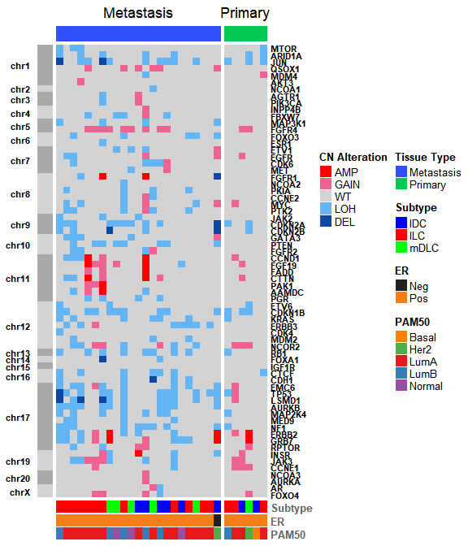<!-- -->

## Sup Figure - Mutational landscape of all (paired + orphan) ovarian metastatic samples and clinical actionability analysis

### Sup Fig 3A - Mutational Frequency Changes Across Ovary Metastasis Cohort

``` r
clinData_select = subset(clinData, Subtype %in% c("IDC","ILC","mDLC") & Study_Code %in% "Ovary")
mutational_change_All = mutational_changes(snv_list, clinData = clinData_select)

supFig3A = ggplot(mutational_change_All, aes(x = genes, y = factor(variable), fill = value)) + 
  geom_tile(alpha = 0.5, show.legend = T, color="black") + 
  scale_fill_gradient("% of samples\nwith mutations", low = "#FAFAFA", high = "#b71c1c", labels = scales::label_number(1)) + 
    myTheme+xlab("")+ylab("")+geom_text(show.legend = F,fontface="bold", aes(label = round(value,1))) +
    coord_flip() + blankTheme + theme(axis.text.x = element_text(color = c(cols)), 
                                      axis.text.y = element_text(color = cols[mutational_change_All$change_type]))+
    scale_color_manual("Change Type", values = cols) + guides(size = FALSE, color = FALSE) + theme(legend.position = "top")
```

``` r
supFig3A
```

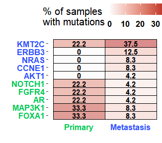<!-- -->

### Sup Fig 3B - Oncoprint by Subtype Across Ovary metastasis Cohort

``` r
SNV_mat = prepare_SNV_matrix(snv_list$filtered_SNVs, clinData)
tumor.ht = generate_oncoprint(split_by = c("Subtype"), clinData = clinData, mat.list.uni = SNV_mat, n_genes = 20)
draw(tumor.ht, merge_legend = TRUE, heatmap_legend_side = "right")
```

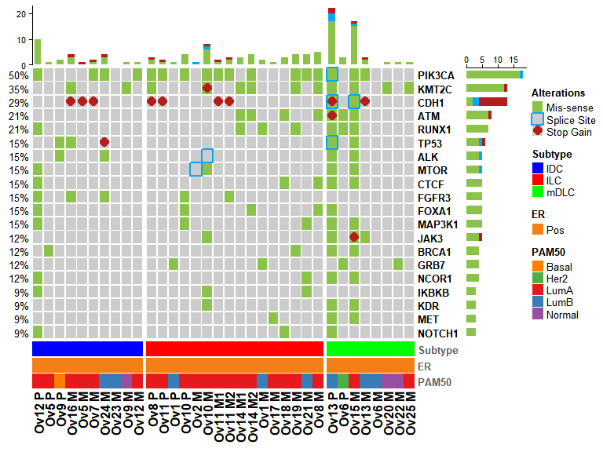<!-- -->

### Sup Fig 3C - Clinically Actionable Mutations

``` r
clinical_variants = clinically_significant_variants(snv_list$filtered_SNVs)
overlapOnco = clinical_variants$overlapOnco
clinical_variants = clinical_variants$clinicalSig.Merged

# UNIQUE
notDuplicated = !duplicated(clinical_variants$gene.variants.combined)
unique.alterations = clinical_variants$gene.variants.combined[notDuplicated]
unique.ClinicalSig.Merged = clinical_variants[notDuplicated,]
drops = c("ID.Variant","Sample.ID.x","Sample.ID.y","SampleID.combined")

# ONCOKB Only
variants.Onco = unique.ClinicalSig.Merged$gene.variants.combined[unique.ClinicalSig.Merged$Detectedby != "PMKB"]

# PMKB Only
variants.PMKB = unique.ClinicalSig.Merged$gene.variants.combined[unique.ClinicalSig.Merged$Detectedby != "OncoKB"]
```

``` r
clinical_variants$`Simple ID` = clinData[clinical_variants$SampleID.combined, "SimpleID"]
clinical_variants$`Sample ID` = clinical_variants$SampleID.combined
clinical_variants$Gene = sapply(strsplit(x = clinical_variants$gene.variants.combined, split = "[.]"), FUN = function(x) { x[1]})
clinical_variants$Mutation = sapply(strsplit(x = clinical_variants$gene.variants.combined, split = "[.]"), FUN = function(x) { x[2]})
clinical_variants$`OncoKB Level` = clinical_variants$Level
clinical_variants$`PMKB Tier` = clinical_variants$PMKB.Tier
clinical_variants$AF = clinical_variants$`AF/CN.y`
clinical_variants$AF[is.na(clinical_variants$AF)] = clinical_variants[is.na(clinical_variants$AF), "AF/CN.x"]

# Supplementary data 1
writexl::write_xlsx(clinical_variants[, c("Simple ID", "Sample ID", "Gene", "Mutation", "OncoKB Level", 
                                          "PMKB Tier","AF", "Detectedby")], 
                    path = "../output/supplementary_data/Data 1 sheet 2 - Actionable Alterations.xlsx")
```

``` r
library(VennDiagram)

futile.logger::flog.threshold(futile.logger::ERROR, name = "VennDiagramLogger")
```

    ## NULL

``` r
venn <- venn.diagram(list(OncoKB = variants.PMKB, PMKB = variants.Onco), # bug - swap labels in input list
                  fill = c("#01579B", "#FF3D00"),alpha = c(0.4, 0.4), cat.cex = c(1.5,1.5), cex = c(1.1,1.1,1.1), lty = 'blank', 
                  fontface = "bold", fontfamily = "sans",cat.fontface = "bold",margin = 0.05,
                  cat.default.pos = "outer",cat.pos = c(0, 10), cat.fontfamily = "sans",
                  ext.text = T,cat.dist = c(0.01, 0.01), filename = NULL)

venn[[5]]$label <- paste(setdiff(variants.PMKB,variants.Onco)  , collapse="\n")
venn[[6]]$label <- paste(setdiff(variants.Onco,variants.PMKB), collapse="\n")
venn[[7]]$label  <- paste(intersect(variants.PMKB, variants.Onco), collapse="\n")

grid.newpage(); grid.draw(venn) # print figure
```

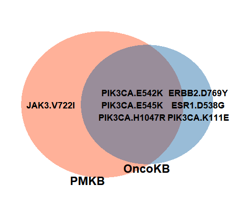<!-- -->

### Sup Fig 3D - Oncoprint of clinically significant variants

``` r
snv_list_pathogenic = subset(snv_list$filtered_SNVs, alteration %in% unique(subset(overlapOnco, Level %in% 3)$combined))
SNV_mat_pathogenic = prepare_SNV_matrix_proteinChange(snv_list_pathogenic, clinData)
pathogenic_tumor.ht = generate_oncoprint(split_by = c("Subtype"), clinData = clinData, mat.list.uni = SNV_mat_pathogenic, n_genes = 20)
draw(pathogenic_tumor.ht, merge_legend = TRUE, heatmap_legend_side = "right")
```

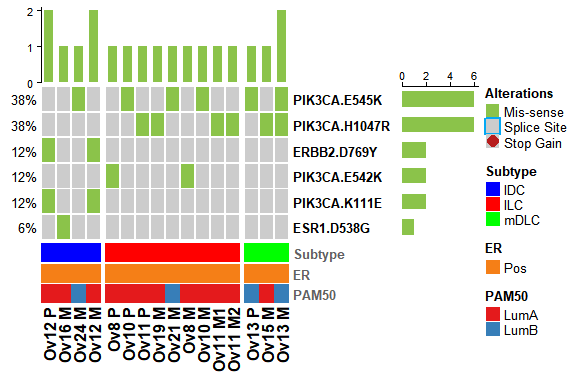<!-- -->

#…………………………………………………

# SESSION INFO

``` r
sessionInfo()
```

    ## R version 4.1.1 (2021-08-10)
    ## Platform: x86_64-w64-mingw32/x64 (64-bit)
    ## Running under: Windows 10 x64 (build 22000)
    ## 
    ## Matrix products: default
    ## 
    ## locale:
    ## [1] LC_COLLATE=English_United States.1252 
    ## [2] LC_CTYPE=English_United States.1252   
    ## [3] LC_MONETARY=English_United States.1252
    ## [4] LC_NUMERIC=C                          
    ## [5] LC_TIME=English_United States.1252    
    ## 
    ## attached base packages:
    ##  [1] parallel  stats4    grid      stats     graphics  grDevices utils    
    ##  [8] datasets  methods   base     
    ## 
    ## other attached packages:
    ##  [1] VennDiagram_1.6.20          futile.logger_1.4.3        
    ##  [3] hypeR_1.8.0                 clusterProfiler_4.0.5      
    ##  [5] org.Hs.eg.db_3.13.0         AnnotationDbi_1.54.1       
    ##  [7] DESeq2_1.32.0               SummarizedExperiment_1.22.0
    ##  [9] Biobase_2.52.0              MatrixGenerics_1.4.3       
    ## [11] matrixStats_0.61.0          GenomicRanges_1.44.0       
    ## [13] GenomeInfoDb_1.28.4         IRanges_2.26.0             
    ## [15] S4Vectors_0.30.2            BiocGenerics_0.38.0        
    ## [17] ComplexHeatmap_2.8.0        vcd_1.4-8                  
    ## [19] circlize_0.4.13             reshape2_1.4.4             
    ## [21] ggthemes_4.2.4              gridExtra_2.3              
    ## [23] EnvStats_2.4.0              cowplot_1.1.1              
    ## [25] ggpubr_0.4.0                ggplot2_3.3.5              
    ## [27] dplyr_1.0.7                 magrittr_2.0.1             
    ## 
    ## loaded via a namespace (and not attached):
    ##   [1] utf8_1.2.2             tidyselect_1.1.1       htmlwidgets_1.5.4     
    ##   [4] RSQLite_2.2.8          BiocParallel_1.26.2    scatterpie_0.1.7      
    ##   [7] munsell_0.5.0          codetools_0.2-18       withr_2.4.2           
    ##  [10] colorspace_2.0-2       GOSemSim_2.18.1        highr_0.9             
    ##  [13] knitr_1.36             rstudioapi_0.13        ggsignif_0.6.3        
    ##  [16] DOSE_3.18.3            labeling_0.4.2         GenomeInfoDbData_1.2.6
    ##  [19] polyclip_1.10-0        bit64_4.0.5            farver_2.1.0          
    ##  [22] downloader_0.4         vctrs_0.3.8            treeio_1.16.2         
    ##  [25] generics_0.1.0         lambda.r_1.2.4         xfun_0.26             
    ##  [28] R6_2.5.1               doParallel_1.0.16      ggbeeswarm_0.6.0      
    ##  [31] clue_0.3-59            graphlayouts_0.7.1     msigdbr_7.4.1         
    ##  [34] locfit_1.5-9.4         bitops_1.0-7           cachem_1.0.6          
    ##  [37] fgsea_1.18.0           gridGraphics_0.5-1     DelayedArray_0.18.0   
    ##  [40] assertthat_0.2.1       promises_1.2.0.1       scales_1.1.1          
    ##  [43] ggraph_2.0.5           enrichplot_1.12.3      beeswarm_0.4.0        
    ##  [46] gtable_0.3.0           Cairo_1.5-12.2         tidygraph_1.2.0       
    ##  [49] rlang_0.4.11           genefilter_1.74.0      systemfonts_1.0.2     
    ##  [52] GlobalOptions_0.1.2    splines_4.1.1          rstatix_0.7.0         
    ##  [55] lazyeval_0.2.2         broom_0.7.9            yaml_2.2.1            
    ##  [58] abind_1.4-5            backports_1.2.1        httpuv_1.6.3          
    ##  [61] qvalue_2.24.0          tools_4.1.1            ggplotify_0.1.0       
    ##  [64] ellipsis_0.3.2         kableExtra_1.3.4       RColorBrewer_1.1-2    
    ##  [67] Rcpp_1.0.7             plyr_1.8.6             visNetwork_2.1.0      
    ##  [70] zlibbioc_1.38.0        purrr_0.3.4            RCurl_1.98-1.5        
    ##  [73] GetoptLong_1.0.5       viridis_0.6.1          zoo_1.8-9             
    ##  [76] haven_2.4.3            ggrepel_0.9.1          cluster_2.1.2         
    ##  [79] futile.options_1.0.1   data.table_1.14.2      magick_2.7.3          
    ##  [82] DO.db_2.9              openxlsx_4.2.4         lmtest_0.9-38         
    ##  [85] mime_0.12              reactable_0.2.3        hms_1.1.1             
    ##  [88] patchwork_1.1.1        evaluate_0.14          xtable_1.8-4          
    ##  [91] XML_3.99-0.8           rio_0.5.27             icesTAF_3.6.0         
    ##  [94] readxl_1.3.1           shape_1.4.6            compiler_4.1.1        
    ##  [97] tibble_3.1.5           writexl_1.4.0          crayon_1.4.1          
    ## [100] shadowtext_0.0.9       htmltools_0.5.2        later_1.3.0           
    ## [103] ggfun_0.0.4            tidyr_1.1.4            geneplotter_1.70.0    
    ## [106] aplot_0.1.1            DBI_1.1.1              formatR_1.11          
    ## [109] tweenr_1.0.2           MASS_7.3-54            babelgene_21.4        
    ## [112] Matrix_1.3-4           car_3.0-11             igraph_1.2.6          
    ## [115] forcats_0.5.1          pkgconfig_2.0.3        foreign_0.8-81        
    ## [118] xml2_1.3.2             roxygen2_7.1.2         foreach_1.5.1         
    ## [121] svglite_2.0.0          ggtree_3.0.4           annotate_1.70.0       
    ## [124] vipor_0.4.5            webshot_0.5.2          XVector_0.32.0        
    ## [127] rvest_1.0.1            yulab.utils_0.0.4      stringr_1.4.0         
    ## [130] digest_0.6.28          Biostrings_2.60.2      rmarkdown_2.11        
    ## [133] cellranger_1.1.0       fastmatch_1.1-3        tidytree_0.3.5        
    ## [136] edgeR_3.34.1           curl_4.3.2             shiny_1.7.1           
    ## [139] rjson_0.2.20           lifecycle_1.0.1        nlme_3.1-153          
    ## [142] jsonlite_1.7.2         carData_3.0-4          limma_3.48.3          
    ## [145] viridisLite_0.4.0      fansi_0.5.0            pillar_1.6.3          
    ## [148] lattice_0.20-45        KEGGREST_1.32.0        fastmap_1.1.0         
    ## [151] httr_1.4.2             survival_3.2-13        GO.db_3.13.0          
    ## [154] glue_1.4.2             zip_2.2.0              png_0.1-7             
    ## [157] iterators_1.0.13       bit_4.0.4              ggforce_0.3.3         
    ## [160] stringi_1.7.5          blob_1.2.2             memoise_2.0.0         
    ## [163] ape_5.5

``` r
writeLines(capture.output(sessionInfo()), paste0("./",Sys.Date(),"-", "_Session Info.txt"))
```
